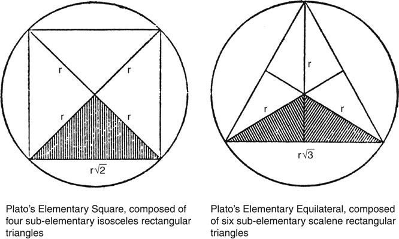
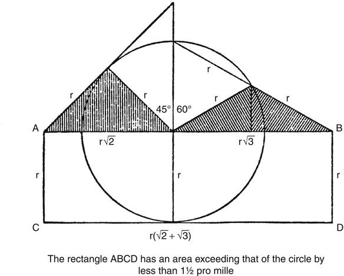

# 《开放社会及其敌人》第6章：极权主义的正义

原文：本地2011年Routledge Classics版EPUB。分组标题`text/part0021.html`；第6章正文`text/part0022_split_000.html`至`text/part0022_split_008.html`；原注`text/part0053_split_000.html`。
用户最新要求直接从“柏拉图的政治纲领／极权主义的正义”开始。此前第3章第Ⅴ—Ⅵ节与原注13—31、第4—5章及对应原注保留未读，不计完成。
已译：章首全部8段及其中5个独立列表项、第Ⅰ节全部5段、原注1—7全部文字。第Ⅱ节全部7段已译；原注8已译，原注9开头及第（1）项已译。下一位置：原注9第（2）项；其余增补（含图示）及原注10—11待译，未进入第Ⅲ节。

## 柏拉图的政治纲领

## 第6章　极权主义的正义

对柏拉图社会学的分析，使我们很容易陈述他的政治纲领。他的根本要求，可以用两种表述中的任何一种来表达：第一种对应于他关于变化与静止的理念论，第二种对应于他的自然主义。理念论的表述是：制止一切政治变化！变化是恶，静止是神圣的。〔1〕如果把国家造成其原型，也就是城邦的形式或理念的精确摹本，就可以制止一切变化。如果有人问，这如何能够实行，我们便可以用自然主义的表述来回答：回到自然！回到我们祖先最初的国家，回到那个按照人性建立、因而稳定的原始国家；回到堕落之前的部落父权统治，回到少数智者对多数无知者实行的自然阶级统治。

我相信，实际上，柏拉图政治纲领的所有要素，都可以从这些要求推导出来。这些要求又建立在他的历史决定论之上；并且，它们必须与他关于阶级统治稳定条件的社会学学说结合起来。我所想到的主要要素是：

（a）严格划分阶级；也就是说，由牧人和看门狗组成的统治阶级，必须同人类牲畜严格分开。

（b）把国家的命运与统治阶级的命运等同起来；只关心这个阶级及其团结；并使以下事项服从于这种团结：对这个阶级的繁育和教育实行严格规定，对其成员的利益实行严密监督和集体化。

从这些主要要素，还可以推导出其他要素，例如：

（c）统治阶级垄断军事德性与训练之类的东西，也垄断携带武器以及接受任何种类教育的权利；但它被排除在任何经济活动之外，尤其不得挣钱。

（d）必须审查统治阶级的一切思想活动，并不断进行宣传，以塑造和统一他们的思想。教育、立法和宗教中的一切革新，都必须被阻止或压制。

（e）国家必须自给自足。它必须以经济上的自给自足为目标；否则，统治者要么依赖商人，要么自己成为商人。前一种情况会削弱他们的权力，后一种则会削弱他们的团结以及国家的稳定。

我认为，把这个纲领描述为极权主义的，是恰当的。而且，它肯定建立在一种历史决定论的社会学之上。

但这就是全部吗？柏拉图的纲领难道没有其他特征，没有既不属于极权主义、也不建立在历史决定论之上的要素吗？柏拉图对善与美的热切追求，或者他对智慧与真理的热爱，又如何呢？他要求智者、哲学家实行统治，又如何呢？他希望使国家的公民既有德性又幸福，又如何呢？他要求国家建立在正义之上，又如何呢？甚至批评柏拉图的作者也相信，尽管存在某些相似之处，他的政治学说仍因这些目标——公民的幸福和正义的统治——而与现代极权主义明确区别开来。例如，克罗斯曼的批判态度，可以从他的一句话看出：“柏拉图的哲学，是历史上对自由主义观念最猛烈、最深刻的攻击。”〔2〕但他似乎仍然相信，柏拉图的计划是“建立一个每位公民都真正幸福的完美国家”。另一个例子是乔德；他相当详细地讨论了柏拉图的纲领与法西斯主义纲领之间的相似性，却断言两者存在根本区别，因为在柏拉图的最佳国家中，“普通人……获得了符合其本性的那种幸福”，而且这个国家建立在“绝对的善和绝对的正义”的观念之上。

尽管有这些论证，我仍相信，柏拉图的政治纲领，在道德上远非优于极权主义，而是在根本上与之相同。我相信，对这一看法的反对意见，建立在一种古老而根深蒂固的偏见之上，即偏爱把柏拉图理想化。克罗斯曼在指出并破除这一倾向方面做了许多工作，这可以从以下论述看出：“在大战之前……柏拉图……很少被直截了当地谴责为一个坚决反对自由主义信条每一项原则的反动思想家。相反，他被抬到一个更高的地位……脱离实际生活，梦想着一座超越尘世的上帝之城。”〔3〕然而，克罗斯曼本人，也未摆脱他如此清楚地揭示出来的这一倾向。值得注意的是，尽管格罗特和贡佩尔茨已经指出《理想国》和《法律篇》中某些学说的反动性质，这一倾向却能够持续如此长久。但即使他们也没有看出这些学说的全部含义；他们从未怀疑，柏拉图在根本上是一个人道主义者。而他们的批评被忽视了，或者被解释为未能理解和欣赏柏拉图；基督徒把柏拉图看作“基督之前的基督徒”，革命者则把他看作革命者。这种对柏拉图的完全信任，无疑仍占支配地位。例如，菲尔德认为，有必要警告读者：“如果我们把柏拉图看作一位革命思想家，就会完全误解他。”这当然非常正确；而且，如果把柏拉图塑造成革命思想家，或至少是进步主义者的倾向并不相当普遍，这句警告显然就毫无意义。但菲尔德本人也对柏拉图抱有同样的信任；因为当他接着说，柏拉图“强烈反对”其时代“新出现的颠覆性倾向”时，他显然过于轻易地接受了柏拉图关于这些新倾向具有颠覆性的证言。自由的敌人，总是指责自由的捍卫者从事颠覆。而且，他们几乎总能成功地说服那些天真而善意的人。

对这位伟大的理念论者的理想化，不仅渗透于对柏拉图著作的解释，也渗透于翻译之中。柏拉图某些激烈的言论，如果不符合译者关于人道主义者应当说些什么的看法，就常常被淡化，或者被误解。这一倾向，从柏拉图那部所谓《Republic》的书名翻译就开始了。当我们听到这个书名时，首先想到的是，作者即使不是革命者，也必定是一位自由主义者。但“Republic”这个书名，只不过是一个希腊词的拉丁语译名的英语形式；那个希腊词并没有这类联想，恰当的英语译法应当是“政制”“城邦”或“国家”。传统的译名“共和国”，无疑助长了人们普遍相信柏拉图不可能是反动思想家的看法。

考虑到柏拉图关于善、正义以及上述其他理念的全部论述，我关于他的政治要求纯属极权主义且反人道主义的论点，需要得到辩护。为进行这一辩护，我将在接下来的四章中，暂时中断对历史决定论的分析，集中批判性地考察上述伦理理念，以及它们在柏拉图政治要求中的作用。在本章，我将考察正义的理念；在接下来的三章中，将考察最有智慧、最优秀者应当统治的学说，以及真理、智慧、善与美的理念。

### Ⅰ

当我们谈论“正义”时，究竟是什么意思？我并不认为，这类词语问题特别重要，也不认为能够给它们一个确定的答案，因为这类词语总是在多种意义上使用。不过，我认为，我们中的大多数人，尤其是那些总体立场属于人道主义的人，所指的大致是这样一些东西：（a）平等分担公民身份所带来的负担，也就是社会生活中必需的那些对自由的限制〔4〕；（b）公民在法律面前受到平等对待，当然，前提是（c）法律既不偏袒，也不歧视个别公民、群体或阶级；（d）法院的公正无私；以及（e）平等分享国家成员身份可能给予公民的利益，而不仅仅是负担。如果柏拉图所说的“正义”是这类东西中的任何一种，那么，我关于他的纲领纯属极权主义的主张，当然就错了；而那些相信柏拉图的政治建立在一种可以接受的人道主义基础之上的人，就都对了。但事实是，他所说的“正义”，意思完全不同。

柏拉图所说的“正义”是什么意思？我断言，在《理想国》中，他把“正义的”一词，当作“符合最佳国家利益的”的同义语来使用。那么，什么符合这个最佳国家的利益呢？通过维持严格的阶级划分和阶级统治，制止一切变化。如果我的这一解释是正确的，那么，我们就不得不说，柏拉图对正义的要求，使他的政治纲领仍停留在极权主义的层面；我们也就不得不得出结论：必须警惕仅仅被词语打动的危险。

正义是《理想国》的中心主题；事实上，“论正义”是它的传统副标题。柏拉图在探究正义的本性时，运用了上一章提到的方法〔5〕：他首先试图在国家中寻找这一理念，然后试图把结果应用于个人。不能说柏拉图的“什么是正义？”这一问题很快就找到了答案，因为答案直到第IV卷才给出。导向这一答案的考虑，将在本章后面得到更充分的分析。简而言之，它们如下。

城邦建立在人性、人的需要和局限之上。〔6〕“我们已经说过，而且你会记得，我们一再重复过：我们城邦中的每个人都应只做一种工作；也就是他的本性天然最适合的那种工作。”由此，柏拉图得出结论，每个人都应当只管自己的事务：木匠应限于做木工，鞋匠应限于做鞋。不过，如果两个劳动者交换其自然位置，并不会造成很大的损害。“但是，如果某个天性属于劳动者——或者属于挣钱阶级——的人……设法进入战士阶级；或者，一个战士在不配的情况下进入护卫者阶级……那么，这种变动和暗中谋划，就意味着城邦的覆亡。”从这一与携带武器应当成为阶级特权的原则紧密相关的论证中，柏拉图得出了最终结论：三个阶级之间的任何变动或混合，都必定是不正义；因此，它的反面就是正义：“当城邦中的每个阶级都只管自己的事务，挣钱阶级如此，辅助者和护卫者也如此，那么，这就是正义。”稍后，这一结论又被重申并概括：“如果城邦的三个阶级各自从事自己的工作……城邦就是正义的。”但这句话意味着，柏拉图把正义等同于阶级统治和阶级特权的原则。因为，每个阶级都应只管自己的事务这一原则，简短而直截了当地说，就是：如果统治者统治，劳动者劳动，而〔7〕奴隶做奴隶，国家就是正义的。

可以看出，柏拉图的正义概念，与上面所分析的我们的通常看法根本不同。柏拉图把阶级特权称为“正义”，而我们通常所说的正义，恰恰是不存在这种特权。但区别还不止于此。我们所说的正义，是对待个人时的某种平等；而柏拉图不把正义看作个人之间的关系，而把它看作整个国家的一种性质，这种性质建立在国家各阶级之间的关系之上。如果国家健康、强大、团结——稳定——它就是正义的。

## 对应原注1—7

**1.** 参见第4章注3及相应正文，尤其是该段末尾；另见该章注2（2）。关于“回到自然”这一表述，我想请读者注意，卢梭深受柏拉图影响。事实上，只要看一看《社会契约论》，就会发现大量相似之处，尤其是与上一章所评论的柏拉图关于自然主义的那些段落。特别参见第9章注14。《理想国》591a及以下，与卢梭以及黑格尔著名的惩罚理论之间，也存在一种有趣的相似性；《高尔吉亚篇》472e及以下，也在个人主义的语境中出现了类似观念。（巴克《希腊政治理论》第I卷，第388页及以下，恰当地强调了柏拉图对卢梭的影响。但他没有看到柏拉图思想中强烈的浪漫主义成分；而且，人们通常没有认识到，经由桑纳扎罗的《阿卡迪亚》而影响法国和莎士比亚时代英国的田园浪漫主义，其源头是柏拉图笔下的多利亚牧人。参见第4章注11（3）、26、32，以及第9章注14。）

**2.** 参见R.H.S.克罗斯曼《今日柏拉图》（1937年），第132页；下一处引文出自第111页。这本有趣的书，与格罗特和T.贡佩尔茨的著作一样，极大地鼓励了我发展自己关于柏拉图的颇不正统的看法，并追随这些看法，直到它们导出相当令人不快的结论。关于C.E.M.乔德的引文，参见他的《道德与政治哲学指南》（1938年），第661、660页。这里，我也可以请读者参看C.L.史蒂文森在“说服性定义”一文中，对柏拉图正义观所作的非常有趣的评论（《心灵》新系列第47卷，1938年，第331页及以下）。

**3.** 参见克罗斯曼前引书，第132页及以下。接下来的两处引文是：菲尔德《柏拉图及其同时代人》，第91页；另参见巴克《希腊政治理论》等书中的类似评论（见第5章注13）。

在关于那些以柏拉图之名流传下来的各种著作是否为真作的争论中，对柏拉图的理想化发挥了相当大的作用。一些批评者拒绝承认其中许多著作，仅仅因为它们包含某些不符合其理想化柏拉图形象的段落。戴维斯与沃恩的“导言”中，可以找到一种相当天真而又典型的态度表达（参见《理想国》金库版，第vi页）：“格罗特先生急于把柏拉图从超人的神坛上拉下来，因此，或许有些过于轻易地把那些被认为配不上如此神圣哲学家的作品归于他。”这些作者似乎没有想到，他们对柏拉图的判断，应当取决于他写了什么，而不是反过来；如果这些作品确实是真作而又不配，那么柏拉图就不是那么神圣的哲学家。（关于柏拉图的神圣性，另见辛普利丘斯《亚里士多德〈论天〉注》，32b44、319a15等。）

**4.** （a）的表述仿照康德的一种表述。康德把正义的政制描述为“一种实现人类个人最大可能自由的政制：它通过如此制定法律，使每个人的自由能够与所有其他人的自由共存”（《纯粹理性批判》第2版，第373页）；另见他的《法权论》，他在那里说：“法权——或正义——是按照一条普遍的自由法则，使每个人的自由选择能够与所有其他人的自由选择共存所必需的条件的总和。”康德相信，这就是柏拉图在《理想国》中追求的目标；由此我们可以看出，康德也是许多哲学家中的一位：他们或者被柏拉图误导，或者通过把自己的人道主义观念归于他，而将他理想化。在这方面，我可以指出，英语和美国的政治哲学著作，对康德热烈的自由主义极少给予应有的重视，尽管有黑斯蒂的《康德的政治原则》。人们过于经常地把他称为黑格尔的先驱；但考虑到他曾在赫尔德和费希特的浪漫主义中，认出一种与自己完全对立的学说，这一说法对康德极不公正，而且毫无疑问，他会对此强烈反感。我相信，正是黑格尔主义的巨大影响，导致这一完全站不住脚的主张被广泛接受。

**5.** 参见第5章注32、33所对应的正文。

**6.** 参见第5章注25—29所对应的正文。本段引文是：（1）《理想国》433a；（2）《理想国》434a/b；（3）《理想国》441d。关于柏拉图在第一处引文中所说的“我们一再重复过”，尤其参见《理想国》397e，那里仔细地为正义理论作了准备；当然，也参见《理想国》369b—c，已引于第5章注29所对应的正文。另见本章注23、40。

**7.** 正如第4章已经指出的（注18及相应正文，以及注29），柏拉图在《理想国》中谈到奴隶的内容不多，尽管他说的内容已经很有意义；但他在《法律篇》中消除了人们对其态度的一切疑问（尤其参见第4章注29提到的G.R.莫罗发表于《心灵》的文章）。

### Ⅱ

但是，柏拉图也许是对的呢？“正义”也许就是他所说的意思呢？我不打算讨论这样的问题。如果有人认为，“正义”意味着一个阶级不受挑战的统治，那么，我只会回答说：我完全赞成不正义。换句话说，我相信，一切都不取决于词语，而取决于我们的实际要求，或者取决于我们决定采纳的、用以制定政策的建议。在柏拉图对正义的定义背后，根本上是他对极权主义阶级统治的要求，以及实现这种统治的决定。

但他是否在另一种意义上是对的呢？他的正义观念，也许符合希腊人使用这个词的方式呢？希腊人所说的“正义”，也许指的是某种整体性的东西，例如“国家的健康”；而期待柏拉图预先提出我们现代的正义观念，即公民在法律面前平等，难道不是极不公正，而且不顾历史的吗？事实上，有人对这一问题作了肯定的回答，并且声称，柏拉图关于“社会正义”的整体主义观念，是传统希腊观点的特征，是“希腊精神”的特征；这种精神“并不像罗马精神那样，特别具有法律性质”，而是“特别具有形而上学性质”。〔8〕但这一主张是站不住脚的。事实上，希腊人使用“正义”一词的方式，与我们自己的个人主义和平等主义用法，确实惊人地相似。

为了说明这一点，我首先可以援引柏拉图本人。他在早于《理想国》的《高尔吉亚篇》中，把“正义就是平等”这一观点，说成是广大民众所持的观点，而且不仅符合“约定”，也符合“自然本身”。我还可以引述亚里士多德，另一位平等主义的反对者；他在柏拉图自然主义的影响下，提出了包括某些人天生就应当做奴隶在内的理论。〔9〕没有人会比他更不愿意传播对“正义”一词的平等主义和个人主义解释。但当亚里士多德谈到法官，并把法官描述为“正义的人格化”时，他说，法官的任务是“恢复平等”。他告诉我们，“所有人都认为，正义是某种平等”，也就是一种“涉及人的”平等。他甚至认为，希腊语中“正义”一词，应当源自一个意为“平等分配”的词根；但在这一点上，他错了。（认为“正义”意味着“在向公民分配财物与荣誉时的某种平等”，这一看法符合柏拉图在《法律篇》中的观点。在那里，柏拉图区分了分配财物与荣誉时的两种平等：“数的”或“算术的”平等，以及“比例的”平等。后一种平等，考虑相关个人在德性、出身与财富方面的程度；而这种比例平等，被说成构成“政治正义”。）当亚里士多德讨论民主的原则时，他说：“民主的正义，是算术平等原则的应用，而不是比例平等原则的应用。”这一切，当然不仅仅是他个人对正义含义的印象，也不只是描述在柏拉图之后，人们如何受到《高尔吉亚篇》和《法律篇》的影响而使用这个词；相反，它表达的是“正义”一词的一种普遍、古老而且通行的用法。〔10〕

鉴于这些证据，我认为，我们必须说，《理想国》中对正义所作的整体主义和反平等主义解释，是一种创新；柏拉图试图把自己的极权主义阶级统治呈现为“正义的”，而人们通常所说的“正义”，却恰恰意味着相反的东西。

这一结果令人吃惊，并提出了一系列问题。如果在通常用法中，正义意味着平等，为什么柏拉图在《理想国》中却声称，正义意味着不平等？在我看来，唯一可能的回答似乎是：他想通过使人们相信，他的极权主义国家就是“正义的”国家，来为它作宣传。但考虑到重要的不是词语，而是我们赋予词语的意思，这样一种尝试值得他去做吗？当然值得；这可以从以下事实看出：他完全成功地说服了他的读者，直到我们这个时代，使他们相信，他是在坦诚地倡导正义，也就是他们自己所追求的那种正义。而且，事实上，他由此在平等主义者和个人主义者中间传播了疑虑与混乱；这些人在他的权威影响下，开始问自己：他的正义观念，是否比他们自己的更真实、更好？由于“正义”这个词，对我们象征着一个如此重要的目标，而且有如此多的人愿意为它忍受一切，并尽自己所能去实现它，那么，争取这些人道主义力量，或者至少使平等主义陷于瘫痪，当然是一个值得极权主义信奉者追求的目标。但柏拉图是否知道，正义对人们有如此重大的意义呢？他知道；因为他在《理想国》中写道：“当一个人做了不正义的事……他的勇气不肯被激发起来，这难道不是真的吗？……但当他相信自己遭受了不正义时，他的活力与愤怒，不是立刻就燃烧起来了吗？当他站在自己认为正义的一方战斗时，他能够忍受饥饿、寒冷和任何艰难，这难道不也同样是真的吗？他不是坚持到取得胜利，保持着激昂的状态，直到达到目标或死去吗？”〔11〕

读到这里，我们就不能怀疑，柏拉图知道信念的力量，尤其是正义信念的力量。我们也不能怀疑，《理想国》必然倾向于歪曲这一信念，并用一种直接相反的信念取代它。而且，鉴于现有证据，在我看来，最可能的是：柏拉图非常清楚自己在做什么。平等主义是他的头号敌人，而他决意摧毁它；毫无疑问，他真诚地相信，平等主义是一种巨大的祸害和危险。但他对平等主义的攻击，并不是一种诚实的攻击。柏拉图不敢公开面对敌人。

下面，我将提出支持这一主张的证据。

## 对应原注8及原注9开头

**8.** 引文出自巴克《希腊政治理论》第I卷，第180页。巴克指出（第176页及以下），“柏拉图式的正义”是“社会正义”，并正确地强调了它的整体主义性质。他提到（第178页及以下），一种可能的批评是，这一表述“没有……触及人们通常所说的正义的本质”，也就是“一项处理意志冲突的原则”，即涉及个人的正义。但他认为，“这样的反对意见没有切中要点”，而且柏拉图的观念“不是法律问题”，而是“一种社会道德观念”（第179页）；他接着断言，这种处理正义的方式，在某种程度上符合希腊当时通行的正义观念：“柏拉图在这一意义上构想正义，也并未远离希腊当时通行的观念。”他甚至没有提及，存在某些相反的证据，而这些证据正是接下来的原注和正文所讨论的。

**9.** 参见《高尔吉亚篇》488e及以下；下面第Ⅷ节将更充分地引述和讨论这一段落，见本章注48及相应正文。关于亚里士多德的奴隶制理论，见第11章注3及相应正文。本段中亚里士多德的引文是：（1）和（2）《尼各马可伦理学》V，4，7和8；（3）《政治学》III，12，1（1282b；另见本章注20、30，该段提到了《尼各马可伦理学》）；（4）《尼各马可伦理学》V，4，9；（5）《政治学》IV（VI），2，1（1317b）。在《尼各马可伦理学》V，3，7中——另参见《政治学》III，9，1，1280a——亚里士多德还提到，“正义”的含义，在民主国家、寡头国家与贵族国家中，会按照它们对“功绩”的不同观念而有所变化。

\*（以下内容最初增补于1950年的美国版。）

关于柏拉图在《法律篇》中对政治正义与平等的看法，尤其参见下面（1）所引关于两种平等的段落（《法律篇》757b—d）。关于正文这里提到的事实，即分配荣誉和财物时，不仅应当考虑德性与出身，还应当考虑财富，甚至身材与相貌，见《法律篇》744c，引于本章注20（1）；那里还讨论了其他相关段落。

（1）在《法律篇》757b—d中，柏拉图讨论了“两种平等”：“其中一种……是度量、重量或数量的平等〔即数的或算术的平等〕；但最真实、最好的平等……给较大者分配较多，给较小者分配较少，按照自然，给予每个人应得的份额……它把较高的荣誉给予德性上较优越的人，把较低的荣誉给予德性和出身上较低的人，按照这一〔合理〕比例原则，把恰当的东西分配给每个人。而这恰恰就是我们所称的‘政治正义’。任何建立国家的人，都必须使这一点成为其立法的唯一目标……：只以这种正义为目标；正如已经说过的，它是自然的平等，并按照具体情形，把它分配给不平等的人。”两种平等中的这第二种，构成了柏拉图这里所称的“政治正义”，以及亚里士多德所称的“分配正义”；柏拉图和亚里士多德把它描述为“比例平等”——最真实、最好、最自然的平等——后来它被称为“几何的”平等（《高尔吉亚篇》508a；另见465b/c，以及普鲁塔克《道德论集》719b及以下），以区别于较低等的、民主的“算术”平等。下面（2）的论述，或许有助于说明这种等同。

〔原注9尚未译完；星号增补在此仍未结束。下次从第（2）项“According to tradition...”继续，随后覆盖图示、其余分项及原注10—11。〕

## 原注9续：第（2）项

（2）按照传说——见《希腊文亚里士多德注疏集》第XV部分，柏林，1897年，第117页第29行，以及第XVIII部分，柏林，1900年，第118页第18行——柏拉图学园门上有一则铭文：“不懂几何的人，不得进入我的屋子！”我怀疑，这句话的含义，并不只是强调数学研究的重要性，而是：“算术——更准确地说，毕达哥拉斯的数论——还不够；你必须懂几何！”下面，我将尝试勾勒一些理由，说明为什么我相信，后一句话恰当地概括了柏拉图对科学最重要的贡献之一。另见第319页补遗。

按照现在普遍接受的看法，早期毕达哥拉斯学派处理几何时，采用了一种颇类似于今天所谓“算术化”的方法。几何被当作整数——或“自然数”，也就是由单子或“不可分单位”组成的数；参见《理想国》525e——及其“logoi”，也就是其“有理”比例的理论的一部分。例如，毕达哥拉斯式的直角三角形，就是各边处于这类有理比例之中的三角形。（例子是3∶4∶5，或5∶12∶13。）一个被归于毕达哥拉斯的一般公式是：

\[2n+1\;:\;2n(n+1)\;:\;2n(n+1)+1.\]

但这个从“gnomon”推导出来的公式，并不具有充分的一般性，正如8∶15∶17这一例子所表明的。一个一般公式如下；令其中的m=n+1，就可以得到毕达哥拉斯的公式：

\[m^2-n^2\;:\;2mn\;:\;m^2+n^2\qquad(m>n).\]

由于这个公式是所谓“毕达哥拉斯定理”的直接推论——如果将这一定理与早期毕达哥拉斯学派似乎已经知道的那种代数结合起来——而且，这个公式显然不仅毕达哥拉斯不知道，甚至柏拉图也不知道；按照普罗克洛斯的说法，柏拉图提出了另一个不具一般性的公式。因此，看来不仅毕达哥拉斯，甚至柏拉图，也不知道“毕达哥拉斯定理”的一般形式。（关于这一问题，一种不那么激进的看法，见T.希思《希腊数学史》，1921年，第I卷，第80—82页。我称作“一般”的公式，实质上是欧几里得的公式；可以从希思第82页那个不必要地复杂的公式中得到它：先求出三角形的三条边，把它们乘以2/(mn)，然后在结果中用m和n替换p和q。）

二的平方根的无理性这一发现——柏拉图在《大希庇阿斯篇》和《美诺篇》中有所暗示；参见第8章注10，另见亚里士多德《前分析篇》41a26及以下——摧毁了毕达哥拉斯学派把几何“算术化”的纲领；随之被摧毁的，似乎还有毕达哥拉斯团体本身的生命力。这一发现起初被保密的传说，似乎得到了以下事实的支持：柏拉图起初仍把无理的东西称为“arrhētos”，也就是秘密、不可言说的奥秘；参见《大希庇阿斯篇》303b/c、《理想国》546c。（一个较晚的术语是“不可通约的”；参见《泰阿泰德篇》147c、《法律篇》820c。“alogos”这个术语，似乎最初出现在德谟克利特那里；他写过两部《论不合逻辑的线与原子》，或者《论不合逻辑的线与充实体》，都已失传。柏拉图知道这个术语，这可以从他在《理想国》534d中，对德谟克利特书名有些不敬的暗示得到证明；但他本人从未把这个词用作“arrhētos”的同义语。现存文献中，第一次毫无疑问地在这一意义上使用它，是亚里士多德《后分析篇》76b9。另见T.希思前引书第I卷，第84页及以下、第156页及以下，以及下文第319页我的第一篇补遗。）

看来，毕达哥拉斯纲领，也就是几何的算术方法的崩溃，导致了欧几里得公理方法的发展。也就是说，一种新方法发展起来：一方面，它旨在从崩溃中挽救可以挽救的东西，包括理性证明的方法；另一方面，它接受几何不可还原为算术。假定上述一切成立，那么似乎极有可能，柏拉图在从较早的毕达哥拉斯方法向欧几里得方法过渡的过程中，发挥了极其重要的作用。事实上，柏拉图可能是最早发展一种专门的几何方法的人之一，其目的在于从毕达哥拉斯主义的崩溃中挽救可以挽救的东西，并尽量减少损失。这其中的许多内容，必须被看作极不确定的历史假说；但可以在上文提到的亚里士多德《后分析篇》76b9中找到某种印证，尤其是把这一段同《法律篇》818c、895e——偶与奇——以及819e/820a、820c——不可通约——相比较时。那段文字写道：“算术预设‘奇’与‘偶’的含义，几何预设‘无理’的含义……”（或者“不可通约”；参见《前分析篇》41a26及以下、50a37。另见《形而上学》983a20、1061b1—3，那里把无理性问题当作几何特有的问题来处理；以及1089a，那里与《后分析篇》76b40一样，暗示了《泰阿泰德篇》147d中的“平方英尺”方法。）柏拉图对无理性问题的极大兴趣，尤其表现在上面提到的两处文字中：《泰阿泰德篇》147c—148a，以及《法律篇》819d—822d。在后一处，柏拉图宣称，他为希腊人感到羞耻，因为他们没有认识到不可通约量这一重大问题。

现在，我提出，“基本物体理论”——在《蒂迈欧篇》53c至62c，或许甚至延续到64a；另见《理想国》528b—d——是柏拉图对这一挑战的回答的一部分。一方面，它保留了毕达哥拉斯主义的原子论性质，也就是不可分的单位，即“单子”，这种单位也在原子论学派中起着作用；另一方面，它引入了二和三的平方根的无理性，此时已经无法避免承认这些无理量存在于世界之中。它的做法是，把那两个引起困难的直角三角形，当作构成其他一切东西的单位：其中一个是正方形的一半，包含二的平方根；另一个是等边三角形的一半，包含三的平方根。事实上，认为这两个无理三角形是一切基本物理物体的界限——peras；参见《美诺篇》75d—76a——或形式的学说，可以说是《蒂迈欧篇》的核心物理学说之一。

这一切都提示，那条针对不懂几何者的警告——《蒂迈欧篇》54a中也许可以找到对它的暗示——可能具有上面提到的更为明确的含义，而且可能与几何比算术更重要的信念有关。（参见《蒂迈欧篇》31c。）而这又可以解释，为什么柏拉图的“比例平等”——按照他的说法，它比民主的算术平等或数的平等更具有贵族性质——后来被等同于他在《高尔吉亚篇》508a中提到的“几何平等”（参见本章注48）；也可以解释，为什么例如普鲁塔克在前引处，把算术和几何分别同民主及斯巴达贵族统治联系起来。尽管如此，以下事实当时显然已经被遗忘：毕达哥拉斯学派与柏拉图本人一样具有贵族倾向；他们的纲领强调算术；而在他们的语言中，“几何的”是某种数的，也就是算术的比例的名称。

〔原注9第（2）项已译完。下一位置为第（3）项“In the Timaeus, Plato needs...”；图示及后续文字仍待译，原注10—11未译。〕

## 原注9续：第（3）—（5）项

（3）在《蒂迈欧篇》中，柏拉图为了构造基本物体，需要一个基本正方形和一个基本等边三角形。这两者又分别由两种不同的次基本三角形组成：正方形的一半，包含√2；等边三角形的一半，包含√3。人们已经广泛讨论过这样一个问题：为什么他选择这两种次基本三角形，而不是正方形和等边三角形本身？同样，第二个问题也引起了广泛讨论——见下面（4）——为什么他用四个而不是两个次基本的半正方形，构造基本正方形；用六个而不是两个次基本的半等边三角形，构造基本等边三角形。（见下面三幅图中的前两幅。）

关于这两个问题中的第一个，人们似乎普遍忽视了以下一点：柏拉图对无理性问题怀有强烈兴趣，如果他不是急于把√2与√3这两个无理量——他在54b中明确提到它们——作为不可还原的要素引入自己的世界，他就不会引入它们。（康福德《柏拉图的宇宙论》第214页、第231页及以下，对这两个问题作了长篇讨论；但他为两者提出的共同解答，即他在第234页所称的“假说”，在我看来完全不能接受。如果柏拉图想实现康福德所讨论的那种“分级”——注意，柏拉图没有暗示存在比康福德所谓“B级”更小的东西——那么，只须把康福德所谓“B级”的基本正方形和等边三角形的边二等分，用四个不包含任何无理量的基本图形组成其中每一个，就已经足够。）但如果柏拉图急于把这些无理量引入世界，作为构成其他一切东西的次基本三角形的边，那么，他必定相信，自己能够以这种方式解决一个问题；而我认为，这一问题就是“〔可通约量与〕不可通约量的本性”（《法律篇》820c）。显然，对于任何运用类似原子论观念的宇宙论来说，这一问题都特别难以解决，因为无理量并不是任何能够量度有理量的单位的倍数；但如果作为量度单位的东西本身包含处于“无理比”中的边，那么，这个巨大的悖论也许就能得到解决：因为这时它们可以量度两者，而无理量的存在也就不再不可理解或“不合理”了。

但柏拉图知道，除了√2和√3之外，还存在其他无理量，因为他在《泰阿泰德篇》中提到，已经发现一个无穷的无理平方根序列——他在148b还谈到“关于立体的类似考虑”，但这未必指立方根，也可能指立方体的体对角线，即√3。他还在《大希庇阿斯篇》中（303b—c；参见希思前引书第304页）提到，把无理量相加，或以其他方式组合，可以得到其他无理数，也可以得到有理数；这可能暗指例如2−√2是无理数这一事实，因为这个数加上√2，当然得到一个有理数。鉴于这些情况，看来，如果柏拉图想通过引入他的基本三角形来解决无理性问题，他就必定认为，一切无理量，或者至少它们的倍数，都可以通过把（a）单位、（b）√2、（c）√3，以及这些量的倍数相加而组成。这当然是错误的，但我们有充分理由相信，当时还不存在反证。而如果我们考虑无理量的相对性质，那么，只有两种原子性的无理量——正方形与立方体的对角线——并且所有其他无理量，相对于（a）单位、（b）√2和（c）√3都是可通约的，这一命题便具有某种可信性。（我指的是这样一个事实：我们可以同样有理由地说，边长为单位长度的正方形，其对角线是无理的；也可以说，对角线为单位长度的正方形，其边是无理的。我们还应记住，欧几里得在第X卷定义2中，仍把一切不可通约的平方根称为“在平方上可通约的”。）因此，柏拉图很可能相信这一命题，尽管他不可能掌握对自己猜想的有效证明。（显然，反证最初由欧几里得给出。）而且，在《蒂迈欧篇》中，柏拉图提到选择这些次基本三角形的理由的那一段，确实提及了某个尚未证明的猜想。因为他写道（《蒂迈欧篇》53c/d）：“一切三角形都由两种三角形导出，它们各有一个直角……；其中一种〔半正方形〕在两侧各有半个直角……，并且有相等的边；另一种〔不等边三角形〕……有不相等的边。我们把这两种假定为第一原理……，按照一种把可能性〔或可能的猜想〕与必然性〔证明〕结合起来的说明。比这些更遥远的原理，只有上天，以及上天所眷顾的人知道。”后来，他说明存在无穷多种不等边三角形，必须从中选出“最好的”；并说明他把半等边三角形看作最好的之后，柏拉图说（《蒂迈欧篇》54a/b；康福德为了使这一段符合自己的解释，不得不校订原文，参见他第214页的注3）：“理由说来太长；但如果有人检验这一问题，并证明它具有这一性质，那么，奖赏就归他，我们衷心祝愿他成功。”柏拉图没有明确说明，“这一性质”是什么意思；它必定是一种可以证明或反驳的数学性质，用来说明：在选择包含√2的三角形之后，选择包含√3的三角形为什么是“最好的”。鉴于上述考虑，我认为，他心中所想的性质，就是其他无理量所被猜测具有的相对有理性，即相对于单位以及二和三的平方根的有理性。

原图图注：左——柏拉图的基本正方形，由四个次基本的等腰直角三角形组成。右——柏拉图的基本等边三角形，由六个次基本的不等边直角三角形组成。

原图图注：矩形ABCD的面积，比圆的面积大不到千分之一点五。

（4）以下考虑也许可以为我们的解释提供一个额外的理由，尽管我在柏拉图的文本中找不到任何进一步的证据。有一个奇特的事实：√2+√3非常接近π。（参见E.博雷尔《空间与时间》，1926、1960年，第216页；W.马里内利在另一个语境中，使我注意到这一事实。）超出的部分小于0.0047，也就是小于π的千分之一点五；当时几乎还不知道更好的π的近似值。对这一奇特事实的一种解释是：外切六边形与内接八边形面积的算术平均值，是圆面积的一个良好近似。现在，一方面，布里松似乎曾运用外切多边形与内接多边形的平均值（参见希思前引书第224页）；另一方面，我们从《大希庇阿斯篇》知道，柏拉图对无理量相加感兴趣，因此，他必定把√2与√3相加过。这样，柏拉图可能通过两条途径发现近似等式√2+√3≈π，而第二条途径似乎几乎不可避免。柏拉图知道这个等式，却无法证明它究竟是严格相等，还是仅仅近似相等，这似乎是一个可信的假说。

但如果如此，那么，我们也许可以回答上面（3）中提到的“第二个问题”：为什么柏拉图用四个而不是两个次基本三角形，即半正方形，组成他的基本正方形；用六个而不是两个次基本三角形，即半等边三角形，组成他的基本等边三角形。如果我们看上面前两幅图，就会发现，这种构造突出显示了外接圆和内切圆的圆心，并在两种情况下都显示了外接圆的半径。（在等边三角形的情况下，内切圆的半径也显示出来了；但柏拉图似乎想到的是外接圆的半径，因为在描述组成等边三角形的方法时，他把它称为“对角线”；参见《蒂迈欧篇》54d/e，另见54b。）

如果我们现在画出这两个外接圆，或者更准确地说，把基本正方形和基本等边三角形内接于半径为r的圆，那么就会发现，这两个图形边长之和近似于rπ。换句话说，柏拉图的构造提示了化圆为方问题的一种最简单的近似解法，正如我们的三幅图所显示的。鉴于这一切，很可能，柏拉图的猜想，以及他在上面（3）中被引述的提供“奖赏，并衷心祝愿成功”的许诺，不仅涉及无理量可通约性的一般问题，也涉及√2+√3是否能使单位圆化方这一特殊问题。

我必须再次强调，我不知道有任何直接证据，表明柏拉图心中所想的就是这一点；但如果考虑这里汇集的间接证据，那么，这一假说也许并不显得过于牵强。我不认为，它比康福德的假说更牵强；而如果它是真的，就会对相关段落作出更好的解释。

（5）如果我们在本注第（2）项中提出的主张有任何道理，即柏拉图的铭文意味着“算术还不够；你必须懂几何！”，以及这一强调与二和三的平方根的无理性的发现有关，那么，这也许可以为理念理论，以及亚里士多德那些备受争论的记述，提供一些启示。它可以解释，为什么鉴于这一发现，毕达哥拉斯学派认为事物——形式、形状——是数，道德观念是数的比的看法，必须消失；也许它被这样一种学说所取代，正如《蒂迈欧篇》中那样：事物的基本形式，或界限——peras，参见上文提到的《美诺篇》75d—76a——或形状，或理念，是三角形。但它也可以解释，为什么一代人之后，学园能够重新回到毕达哥拉斯的学说。一旦无理性的发现所造成的震荡平息，数学家便开始习惯于这样一种观念：尽管如此，无理量必定也是数，因为它们与其他有理数之间，具有大于或小于的基本关系。到了这一阶段，反对毕达哥拉斯主义的理由就消失了，尽管在承认无理量之后，形状是数或数的比这一理论，所意味着的东西已经与此前不同；新理论的拥护者可能并未充分认识到这一点。另见第319页补遗I。*

## 原注10—11

**10.** 众所周知，忒弥斯被表现为蒙着双眼，也就是不考虑请求者的身份地位，并且手持天平，也就是平等地分配，或平衡争执中的个人的要求与利益。这是平等主义正义观念的一种象征性表现。不过，这种表现不能在这里被用作论据，支持这一观念在柏拉图时代已经通行的主张；因为正如E.H.贡布里希教授善意地告诉我的，它起源于文艺复兴时期，受到普鲁塔克《论伊西斯与奥西里斯》中某段文字的启发，而不是来自古典希腊。* 另一方面，狄刻手持天平的表现，确实属于古典时代——关于柏拉图之后一代人的雕塑家提摩卡瑞斯所作的这种表现，见R.艾斯勒《占星术的王家技艺》，1946年，第100、266页及图版5——并且很可能可以追溯到赫西俄德把室女座与狄刻等同起来，因为天平就在它旁边。鉴于这里提供的其他证据，说明正义或狄刻与分配上的平等相联系，天平很可能具有与忒弥斯的天平相同的含义。*

**11.** 《理想国》440c—d。这一段以一个典型的牧羊犬比喻结束：“或者，直到它被自己的理性的声音召回并安抚下来，就像狗被牧人召回一样？”参见第4章注32（2）。

〔原注9及对应原注10—11全部译完。下一位置：第6章第Ⅲ节，text/part0022_split_003.html。原文件把部分根号显示为Ö、π显示为p，并含损坏字符ȁ4；公式依据原图及明确上下文恢复记号，原图保留不改。〕

### Ⅲ

《理想国》可能是有史以来关于正义最详尽的专著。它考察了关于正义的各种观点，而且它的考察方式，使我们相信，柏拉图没有遗漏他所知道的任何较重要的理论。事实上，柏拉图明确暗示〔12〕，由于他试图在当时通行的观点中追寻正义，却徒劳无功，因此有必要重新寻找正义。然而，在他对当时通行理论的考察与讨论中，正义就是法律面前的平等——isonomy——这一观点，从未被提及。这一遗漏只能有两种解释：要么他忽略了平等主义理论〔13〕，要么他有意避而不谈。如果考虑到《理想国》写作得如此精心，以及柏拉图要有力地提出自己的理论，就必须分析对手的理论，那么第一种可能性似乎很小。而如果考虑到平等主义理论广受欢迎，这一可能性就显得更加不可信。不过，我们不必仅仅依赖或然性的论证，因为很容易证明，柏拉图在写作《理想国》时，不仅熟悉平等主义理论，而且充分意识到它的重要性。正如本章第Ⅱ节已经提到的，并将在后面的第Ⅷ节详细说明的，平等主义在较早的《高尔吉亚篇》中发挥了相当大的作用，甚至在那里得到辩护。尽管《理想国》没有在任何地方认真讨论平等主义的优点或缺点，柏拉图却没有改变对其影响力的看法，因为《理想国》本身就证明了它的流行。在那里，它被暗指为一种十分流行的民主信念；但它只受到轻蔑的对待，我们所听到的全部内容，只是几句讥讽和挖苦〔14〕，与针对雅典民主的谩骂式攻击十分相称，而且出现在并不以正义为讨论主题的地方。因此，柏拉图忽略了平等主义正义理论的可能性被排除了；他没有看出必须讨论一种有影响力、又与自己的理论截然对立的理论的可能性，也被排除了。他在《理想国》中的沉默，只被几句诙谐的话打破——显然，他认为这些话太精彩，不应删去〔15〕——这一事实，只能被解释为有意识地拒绝讨论它。鉴于这一切，我看不出，柏拉图让读者相信所有重要理论都已经得到考察的这种方法，如何能与思想诚实的标准相协调；不过，我们必须补充，他的这一失误，无疑是由于他完全献身于一个他坚信为善的事业。

为了充分理解柏拉图在这一问题上几乎始终保持沉默的含义，我们必须首先清楚地看到：柏拉图所知道的平等主义运动，代表了他所憎恨的一切；而他在《理想国》以及所有后期著作中的理论，在很大程度上，是对新的平等主义与人道主义所提出的强大挑战的回应。为了说明这一点，我将讨论人道主义运动的主要原则，并把它们同柏拉图式极权主义的相应原则加以对照。

人道主义的正义理论，提出三个主要要求或建议，即：（a）严格意义上的平等主义原则，也就是消除“自然”特权的建议；（b）个人主义的一般原则；（c）国家的任务与目的应当是保护其公民自由的原则。这些政治要求或建议中的每一项，都对应着柏拉图主义中一个直接相反的原则，即：（a₁）自然特权原则；（b₁）整体主义或集体主义的一般原则；（c₁）个人的任务与目的应当是维持并加强国家稳定的原则。我将依次讨论这三点，在本章第Ⅳ、Ⅴ、Ⅵ节中，各用一节讨论其中一点。

## 对应原注12—15

**12.** 事实上，当柏拉图两次把苏格拉底写成对于如今应到哪里寻找正义颇为疑惑时，他就暗示了这一点。（参见368b及以下、432b及以下。）

**13.** 亚当在《理想国》331e及以下的注释中，显然受到柏拉图影响，忽略了平等主义理论。他在那里说：“认为正义在于对朋友行善、对敌人施害的观点，忠实地反映了当时通行的希腊道德。”这一说法很可能是正确的。但当他补充说，这是一种“几乎普遍的观点”时，他就错了；因为他忘记了自己提供的证据——561e28的注释——它表明，法律面前的平等，即isonomy，“是民主引以为傲的主张”。另见本章注14、17。

关于isonomy最古老的记载之一——即使不是最古老的——可以在医生阿尔克迈翁的一则残篇中找到；他生活于公元前5世纪初，见狄尔斯第5版，第24章，残篇4。他把isonomy说成健康的一项条件，并把它同“君主统治”相对立，也就是一者对多者的支配。在这里，我们有一种关于身体，或者更准确地说，关于人体生理学的政治理论。另见第5章注32、第10章注59。

**14.** 《理想国》359c中格劳孔的发言，顺带提到过平等，类似于《高尔吉亚篇》483c/d中的说法；另见本注下文及本章注47。但这一问题并没有被继续讨论。（关于这一段，参见本章注50。）

在柏拉图对民主的谩骂式攻击中——见第4章注14—18所对应的正文——出现了三处对平等主义轻蔑而诙谐的提及。第一处评论的意思是，民主“把平等同样分配给平等者与不平等者”（558c；参见亚当对558c16的注释，另见本章注21）；其意图是讽刺性的批评。（此前，在对民主革命的描述中，平等已经与民主联系起来；参见《理想国》557a，引于第4章注13所对应的正文。）第二处把“民主的人”描述为“平等地”满足自己的所有欲望，无论这些欲望是好是坏；因此，他被称为“平等主义者”，即isonomist，这是对“所有人享有平等的法律”或“法律面前平等”——isonomy，参见本章注13、17——这一观念的双关暗示。这一双关出现在《理想国》561e。此前已经为它充分铺垫，因为“平等”这个词已经被使用了三次（《理想国》561b、c），用来描述那种把一切欲望与奇想都看作“平等”的人的态度。第三处低劣的讥讽，是诉诸读者的想象，甚至在今天，也是这类宣传的典型做法：“我差点忘了提到，这些著名的‘平等法律’，以及这种著名的‘自由’，在人与女人的相互关系中所发挥的重大作用……”（《理想国》563b。）

除了这里提到的关于平等主义重要性的证据，以及本章注9—10所对应的正文之外，我们尤其必须考虑柏拉图本人的证言：（1）《高尔吉亚篇》，他在那里写道（488e/489a；另见本章注47、48、50）：“民众——这里即大多数人——不是相信……正义就是平等吗？”（2）《美涅克塞努篇》（238e—239a；见本章注19及相应正文）。《法律篇》中关于平等的段落，晚于《理想国》，不能被用作证言，证明柏拉图在写作《理想国》时已经意识到这一问题；但参见本章注9、20、21所对应的正文。

**15.** 关于第三处评论，柏拉图本人说（563b；参见上一注）：“凡是来到嘴边的话，我们都要说出来吗？”显然，他借此表示，他看不出有什么理由不说这个笑话。

〔第Ⅲ节正文3段及原注12—15已译完。下一位置为第6章第Ⅳ节，text/part0022_split_004.html。〕

### Ⅳ（第1—7段）

严格意义上的平等主义，要求国家的公民受到公正无私的对待。它要求，出身、家族关系或财富，不得影响那些对公民执法的人。换句话说，它不承认任何“自然”特权，尽管公民可以把某些特权授予他们信任的人。

柏拉图出生前几年，伯里克利在一篇由修昔底德保存下来的演说中，出色地表述了这一平等主义原则。〔16〕第10章将更充分地引述这篇演说，但这里可以先给出其中两句话：“我们的法律，”伯里克利说，“在私人争端中，给予所有人同样平等的正义，但我们并不忽视优秀者的资格。当一位公民表现出众时，他便被优先选任公职；这不是特权问题，而是对功绩的报偿；贫穷也不是障碍……”这些话表达了伟大的平等主义运动的一些根本目标；正如我们已经看到的，这一运动甚至不畏惧攻击奴隶制。在伯里克利那一代人中，这一运动的代表是欧里庇得斯、安提丰和希庇阿斯，上一章已经引述过他们；还有希罗多德。〔17〕在柏拉图那一代人中，它的代表是上文引述过的阿尔基达马斯和吕科弗隆；另一位支持者是安提斯泰尼，他曾是苏格拉底最亲密的朋友之一。

柏拉图的正义原则，当然与这一切截然相反。他要求，天然的领袖应当享有自然特权。但他怎样反驳平等主义原则？又怎样确立自己的要求呢？

读者会记得，上一章说过，平等主义要求的某些最著名表述，使用了令人印象深刻、却有问题的“自然权利”语言；其中一些代表人物，通过指出人的“自然”平等，也就是生物学上的平等，来论证这些要求。我们已经看到，这一论证与问题无关；人在某些重要方面平等，在另一些方面不平等；而规范性的要求，不能从这一事实，或任何其他事实中推导出来。因此，值得注意的是，并非所有平等主义者都使用了自然主义论证；例如伯里克利，甚至没有暗示过它。〔18〕

柏拉图很快发现，自然主义是平等主义学说内部的一个弱点，并充分利用了这一弱点。告诉人们，他们彼此平等，具有某种感情上的吸引力。但与告诉他们“你们优于别人，而别人低于你们”的宣传所产生的吸引力相比，前者的吸引力很小。你在自然上与你的仆人、奴隶，以及那些并不比动物高明的体力劳动者平等吗？这个问题本身就很荒谬！柏拉图似乎是第一个认识到这种反应所蕴含的可能性的人，并以轻蔑、鄙视和嘲笑来对抗自然平等的主张。这就解释了，为什么他急于把自然主义论证，甚至归于那些没有使用它的对手。因此，在《美涅克塞努篇》这篇对伯里克利演说的戏仿中，他坚持把平等法律的要求与自然平等的要求联系起来：“我们政制的基础，是出生的平等，”他讽刺地说。“我们都是兄弟，都是同一位母亲的孩子……而出生的自然平等，促使我们争取法律面前的平等。”〔19〕

后来，在《法律篇》中，柏拉图用以下表述概括了他对平等主义的回答：“平等地对待不平等者，必定产生不公。”〔20〕亚里士多德把它发展为：“平等者应受平等对待，不平等者应受不平等对待。”这一表述，体现了可以称作反对平等主义的标准异议：如果人们平等，平等当然很好；但由于人们并不平等，而且无法使他们平等，平等显然是不可能的。这一看似十分现实的异议，事实上极不现实，因为政治特权从来不曾建立在人的性格的自然差异之上。而且，柏拉图在写作《理想国》时，似乎对这一异议没有很大信心，因为它在那里只被用于他对民主的一次讥讽中：他说，民主“把平等同样分配给平等者与不平等者”。〔21〕除了这一评论之外，他宁愿不去反驳平等主义，而把它忘掉。

总而言之，可以说，柏拉图从未低估平等主义理论的意义，因为它得到伯里克利这样的人物的支持；但在《理想国》中，他根本没有处理这一理论。他攻击了它，却没有直接而公开地攻击。

## 对应原注16—21

**16.** 我相信，修昔底德（II，37及以下）所记述的伯里克利演说，实际上可以被认为是真实可靠的。伯里克利演说时，他极有可能在场；无论如何，他都会尽可能忠实地重构它。有许多理由相信，在那个时代，一个人甚至把另一个人的演说背下来，并不是什么不寻常的事情——参见柏拉图《斐德若篇》——而忠实地重构这样一篇演说，确实没有人们可能想象的那么困难。柏拉图知道这篇演说，并把修昔底德的版本，或另一个必定与它极其相似的来源，视为真实可靠的。另见第10章注31、34、35。（这里可以提到，伯里克利在政治生涯早期，曾对流行的部落本能，以及同样流行的民众群体利己主义，作出一些颇值得怀疑的让步；我想到的是公元前451年关于公民身份的立法。但后来，他改变了对这些问题的态度，很可能受到普罗泰戈拉等人的影响。）

**17.** 参见希罗多德，III，80，尤其是对isonomy，即法律面前平等的颂扬（III，80，6）；另见本章注13、14。这段希罗多德的文字，在其他方面也影响了柏拉图——参见第4章注24——而柏拉图在《理想国》中嘲弄它，正如他嘲弄伯里克利的演说一样；参见第4章注14、第10章注34。

**18.** 即使自然主义者亚里士多德，也并非总是提到平等主义的这一自然主义版本；例如，他在《政治学》1317b中对民主原则的表述——参见本章注9及相应正文——完全独立于它。但也许更有趣的是，在自然与约定的对立发挥如此重要作用的《高尔吉亚篇》中，柏拉图呈现平等主义时，并没有用“一切人在自然上平等”这一可疑理论来加重它的负担。见488e/489a，引于本章注14，以及483d、484a、508a。

**19.** 参见《美涅克塞努篇》238e/239a。这一段紧接着一处对伯里克利演说的明确暗示，即本章注17所对应的正文中引述的第二句话。这段文字中反复使用“出生平等”一词，很可能是对伯里克利与阿斯帕西娅的儿子们的“低微”出身所作的轻蔑暗示；这些人直到公元前429年，才通过特别立法被承认为雅典公民。（参见E.迈耶《古代史》第IV卷，第14页第392条的注，以及第323页第558条。）

有人认为，甚至格罗特也这样认为——参见他的《柏拉图》第III卷，第11页——柏拉图在《美涅克塞努篇》中，“在他自己的修辞性论述中……放下了讽刺的语调”；也就是说，正文引文所在的《美涅克塞努篇》中间部分，并不是讽刺性的。但鉴于上面所引关于平等的段落，以及柏拉图在《理想国》中处理这一问题时公开表现出的鄙视——参见本章注14——这一看法在我看来站不住脚。在我看来，同样不可能怀疑，紧接正文所引段落之前的一段，也具有讽刺性质；柏拉图在那里谈到雅典说（参见238c/d）：“在那时，也如同现在……我们的政府始终是贵族政体……；虽然它有时被称为民主政体，但实际上它是贵族政体，也就是说，经多数人认可的最优秀者的统治……”鉴于柏拉图对民主的憎恨，这一描述无须进一步评论。* 另一处无疑具有讽刺性质的段落是245c—d——参见第8章注48——在那里，“苏格拉底”赞扬雅典一贯憎恨外邦人与蛮族。由于在别处，即《理想国》562e及以下，引于第8章注48，他在攻击民主，也就是雅典民主时，因雅典宽容地对待外邦人而鄙视它，因此，《美涅克塞努篇》中的赞扬只能是讽刺：一位亲斯巴达的党人，再次嘲弄雅典的宽容。（吕库古的一项法律禁止外邦人居住在斯巴达；参见阿里斯托芬《鸟》1012。）在这方面，值得注意的是，在《美涅克塞努篇》236a——参见第10章注15（1）——中，“苏格拉底”是一位攻击雅典的演说者；柏拉图说，“苏格拉底”曾是寡头派领袖、拉姆努斯的演说家安提丰的学生，不要把他与雅典的智者安提丰混淆。这一点尤其值得注意，因为“苏格拉底”戏仿的是修昔底德记录的一篇演说；而修昔底德似乎确实曾是安提丰的学生，并非常钦佩他。* 关于《美涅克塞努篇》的真实性，另见第10章注35。

**20.** 《法律篇》757a；参见整个段落757a—e，其中主要部分已在上文本章注9（1）引述。

（1）关于我所称的反对平等主义的标准异议，另参见《法律篇》744b及以下：“如果每个人都能够……在一切方面平等，那当然很好；但由于这是不可能的……”等等。这一段尤其有趣，因为许多仅凭《理想国》判断柏拉图的作者，常常把他描述为富豪统治的敌人。但在《法律篇》这一重要段落，即744b及以下，柏拉图要求：“政治职位、缴纳的份额以及分配，都应当与公民财富的价值成比例。而且，它们不仅应取决于他的德性、祖先的德性、身材和相貌，也应取决于他的财富或贫穷。这样，一个人便会尽可能公平地获得荣誉与职位，也就是与其财富成比例，尽管所依据的是一种不平等分配的原则。”* 按照财富与身材，不平等地分配荣誉，以及我们可以假定的战利品，这一学说很可能是英雄征服时代的遗留。装备厚重而昂贵的富人，以及强壮的人，对胜利的贡献超过其他人。（这一原则在荷马时代受到认可；R.艾斯勒向我保证，几乎所有已知的征战部落都有这一原则。）* 这一态度的基本观念，即平等地对待不平等者是不正义的，早在《普罗泰戈拉篇》337a的一句顺带评论中就可以找到；另见《高尔吉亚篇》508a及以下，已在本章注9、48中提到。但在写作《法律篇》之前，柏拉图并未大量运用这一观念。

（2）关于亚里士多德对这些观念的发展，尤其参见他的《政治学》III，9，1，1280a；另见1282b—1284b、1301b29。他在那里写道：“所有人都坚持某种正义，但他们的观念并不完善，也没有包含完整的理念。例如，〔民主派〕认为正义是平等；正义确实是平等，尽管它不是所有人的平等，而只是平等者的平等。〔寡头派〕认为正义是不平等；正义确实是不平等，尽管它不是所有人的不平等，而只是不平等者的不平等。”另参见《尼各马可伦理学》1131b27、1158b30及以下。

（3）反对所有这些反平等主义观点，我与康德一道认为，一切道德都必须以这样一个原则为基础：任何人都不应认为，自己比其他任何人更有价值。而且，我断言，考虑到众所周知的事实，即人不可能公正地判断自己，这一原则是唯一可以接受的原则。因此，我无法理解卡特林这样一位优秀作者的以下评论（《原则》第314页）：“康德的道德试图把一切人格压平……，忽视亚里士多德的准则，即给予平等者平等、给予不平等者不平等；这种道德中存在某种深刻的不道德……一个人在社会上并不具有与另一个人相同的权利……本书作者绝不准备否认……‘血统’中确实存在某种东西。”现在我问：即使“血统”，或者才能的不平等之类的东西中，确实存在某种东西；即使值得浪费时间去评估这些差异；即使人能够评估它们；那么，为什么这些差异应当成为享有更大权利的根据，而不仅仅是承担更重义务的根据？参见第4章注31、32所对应的正文。我看不出康德的平等主义有什么深刻的不道德。而且，我看不出卡特林的道德判断建立在什么基础上，因为他把道德看作品味问题。为什么康德的“品味”会深刻地不道德？它也是基督教的“品味”。对于这一问题，我唯一能够想到的回答是：卡特林从自己的实证主义立场出发作判断——参见第5章注18（2）——并且认为，基督教与康德的要求之所以不道德，是因为它们违背了我们当代社会实际强制实行的道德评价。

（4）对于所有这些反平等主义者，卢梭给出了有史以来最好的回答之一。尽管我认为，他的浪漫主义——参见本章注1——是社会哲学史上最有害的影响之一，我仍然这样说。但他也是这一领域中少数真正杰出的作者之一。我从《论不平等的起源》中引述他的一段精彩评论——例如见《社会契约论》人人文库版第174页；强调为我所加——并请读者注意，这一段最后一句话的庄重表述。

“我认为，人类中存在两种不平等：一种，我称为自然的或身体的不平等，因为它由自然确立，包括年龄、健康、体力，以及心智或灵魂品质的差异；另一种，可以称为道德的或政治的不平等，因为它取决于某种约定，并由人们的同意确立，或至少认可。后一种不平等，包括某些人所享有的不同特权……，例如更富有、更受尊重或更有权势……追问自然不平等的来源，是没有用的，因为只要给这个词下定义，就已经回答了这一问题。进一步追问这两种不平等之间是否存在某种本质联系，更加没有用；因为换句话说，这无非是在问：发号施令的人是否必定比服从的人更优秀，体力或心智的力量、智慧或德性，是否总是……与一个人的权力或财富成比例。这一问题，也许适合奴隶在主人听得见的地方讨论，却极不适合追求真理的理性而自由的人。”

**21.** 《理想国》558c；参见本章注14，即攻击民主时的第一处引文。

〔第Ⅳ节前7段及原注16—21已译完。下一位置为同节第8段“But how did he try to establish his own anti-equalitarianism...”，text/part0022_split_004.html。〕

### Ⅳ（续，第8—15段）

但他怎样试图确立自己的反平等主义，即自然特权原则呢？在《理想国》中，他提出了三个不同的论证，尽管其中两个几乎不配称为论证。第一个〔22〕是一个令人惊讶的说法：既然国家的其他三种德性都已经得到考察，那么剩下的第四种德性，即“只管自己的事务”，就必定是“正义”。我不大愿意相信，这被当作一个论证来提出；但它必定如此，因为柏拉图的主要发言者“苏格拉底”以这样一个问题引出它：“你知道我是怎样得出这个结论的吗？”第二个论证更有意思，因为它试图说明，他的反平等主义可以从通常的，也就是平等主义的“正义就是公正无私”这一看法中推导出来。我把这一段完整引出。“苏格拉底”在指出城邦的统治者也将担任法官之后，说〔23〕：“他们司法的目标，难道不就是使任何人既不占有属于别人的东西，也不被剥夺属于自己的东西吗？”对话者“格劳孔”回答：“是的，这会是他们的意图。”“因为这样才是正义的？”“是的。”“因此，保有属于我们、为我们所有的东西，并从事我们自己的事务，将普遍被认为是正义。”这样，按照我们通常的正义观念，“保有并从事自己的东西”便被确立为公正司法的原则。第二个论证到此结束，让位于第三个论证——下文将分析它——后者得出的结论是：保持自己的地位，或从事自己的事务，就是正义；而这一地位或事务，就是自己所属阶级或等级的地位或事务。

这第二个论证的唯一目的，就是让读者相信，在这个词的通常意义上，“正义”要求我们保持自己的地位，因为我们总应保有属于自己的东西。也就是说，柏拉图希望读者作出这样的推论：“保有并从事自己的东西，是正义的。我的地位或事务，是我自己的。因此，保持我的地位，或从事我的事务，是正义的。”这一论证的可靠程度，大致与以下论证相当：“保有并从事自己的东西，是正义的。这个偷你钱的计划，是我自己的。因此，坚持我的计划，并把它付诸实践，也就是偷你的钱，是正义的。”显然，柏拉图希望我们作出的推论，无非是对“自己的”这一用语的含义作一种粗劣的戏法。（因为问题在于，正义是否要求：凡在某种意义上是“我们自己的”东西，例如“我们自己的”阶级，因此都不仅应被当作我们的所有物，而且应被当作我们不可让渡的所有物。但柏拉图本人并不相信这样的原则；因为它显然会使向共产主义的过渡成为不可能。至于保有我们自己的孩子，又如何呢？）这种粗劣的戏法，就是柏拉图建立亚当所称的“他自己的正义观与这个词的通俗……含义之间的联系”的方式。有史以来最伟大的哲学家，就是这样试图使我们相信，他已经发现了正义的真正本性。

柏拉图提出的第三个，也是最后一个论证，要严肃得多。它诉诸整体主义或集体主义原则，并与个人的目的在于维持国家稳定这一原则相联系。因此，在本次分析中，它将在下面第Ⅴ、Ⅵ节得到讨论。

但在转向这些问题之前，我想请读者注意，柏拉图在描述我们这里考察的“发现”之前所放置的“前言”。必须根据我们迄今所作的观察来看待它。从这一角度看，这篇“冗长的前言”——柏拉图本人就是这样称呼它的——表现为一种巧妙的尝试：通过使读者相信有一个论证正在展开，来为“发现正义”作准备；而实际上，读者面对的只是一套戏剧手法的展示，目的是使他的批判能力平静下来。

在发现智慧是护卫者特有的德性，勇敢是辅助者特有的德性之后，“苏格拉底”宣布，他打算作最后一次努力，以发现正义。他说：“还剩两样东西〔24〕，我们必须在城邦中发现它们：节制，以及最后那件作为我们一切研究主要目标的东西，也就是正义。”“正是如此，”格劳孔说。苏格拉底现在建议，略过节制。但格劳孔提出抗议，苏格拉底于是让步，说拒绝会是“不对的”，或“歪曲的”。这场小争论，为读者重新面对正义作了准备，暗示苏格拉底掌握了“发现”它的手段，并使读者放心：格劳孔正在仔细监督柏拉图进行论证时的思想诚实，因此，读者本人完全不必再监督了。〔25〕

接着，苏格拉底开始讨论节制；他发现，这是劳动者唯一适有的德性。（顺便说来，关于柏拉图的“正义”是否可以与他的“节制”区分开来，这一备受争论的问题，很容易回答。正义意味着保持自己的位置；节制意味着知道自己的位置，也就是，更准确地说，安于自己的位置。对于那些像牲畜一样填饱肚子的劳动者，还有什么其他德性是适合他们的呢？）发现节制之后，苏格拉底问：“那么，最后一个原则呢？显然，它就是正义。”“显然，”格劳孔回答。

“现在，我亲爱的格劳孔，”苏格拉底说，“我们必须像猎人一样，包围她的藏身处，密切监视，不能让她逃脱、溜走；因为正义肯定就在这一带。你最好留神，搜寻这个地方。如果你先看到她，就喊我一声！”格劳孔和读者一样，当然完全做不到这种事，于是恳求苏格拉底带头。“那么，和我一起祈祷，”苏格拉底说，“然后跟着我。”但即使苏格拉底，也发现这片地方“难以穿行，因为它被灌木覆盖；这里阴暗，难以探查……不过，”他说，“我们必须继续。”格劳孔并没有抗议：“继续什么？继续我们的探查，也就是我们的论证？但我们甚至还没有开始。你迄今所说的话，连一点有意义的东西都没有。”相反，他和天真的读者一道，温顺地回答：“是的，我们必须继续。”这时，苏格拉底报告说，他已经“瞥见了一点”——我们并没有——并兴奋起来。“好啊！好啊！”他喊道，“格劳孔！似乎有踪迹了！我现在认为，猎物不会从我们手中逃掉了！”“这是好消息，”格劳孔回答。“我敢说，”苏格拉底说，“我们把自己弄成了彻头彻尾的傻瓜。我们到远处寻找的东西，其实一直就在我们脚下！而我们竟从未看到它！”苏格拉底用这类惊叹和反复断言，继续说了好一阵；格劳孔打断他，表达读者的感受，问苏格拉底发现了什么。但当苏格拉底只是说：“我们一直在谈论它，却没有意识到，我们实际上正在描述它”时，格劳孔表达了读者的不耐烦，说：“这篇前言有点冗长了；记住，我想听的是，这到底是怎么回事。”只有到这时，柏拉图才开始提出我已经概述的那两个“论证”。

格劳孔最后这句话，可以被看作一种迹象，表明柏拉图清楚自己在这篇“冗长的前言”中做了什么。我只能把它解释为一种尝试——事实证明，这一尝试极为成功——即使读者的批判能力昏昏欲睡，并借助一场戏剧性的语言烟火表演，把读者的注意力从这段技巧高超的对话在思想上的贫乏之处移开。人们不免想到，柏拉图知道它的弱点，也知道怎样掩盖它。

## 对应原注22—25

**22.** 《理想国》433b。亚当也承认，这一段意在提出一个论证，并试图重构这个论证——433b11的注释；但他承认：“柏拉图在推理中，很少留下这么多东西，需要读者在心中补足。”

**23.** 《理想国》433e/434a。关于这一段的后续，参见本章注40所对应的正文；关于《理想国》较早部分为它所作的准备，见本章注6。对于我称为“第二个论证”的段落，亚当评论如下（433e35的注释）：“柏拉图正在寻找他自己的正义观，与这个词通俗的司法含义之间的联系……”见下一段正文中的引文。亚当试图维护柏拉图的论证，反对一位批评者克罗恩；后者已经看出其中有问题，尽管也许看得并不十分清楚。

**24.** 本段引文出自《理想国》430d及以下。

**25.** 这一手法似乎甚至对贡佩尔茨这样敏锐的批评者也取得了成功。他在简短的批评中——《希腊思想家》第V编，II，10；德文版第II卷，第378—379页——没有提到论证的弱点；而且，在评论前两卷时（V，II，5；第368页），他甚至说：“接下来是一段论述，可以称为清晰、精确和真正科学性质的奇迹……”并补充说，柏拉图的对话者格劳孔与阿德曼托斯，“受到炽热激情的驱使……排斥并预先阻止一切肤浅的解答”。

关于我在下一段正文中对节制的评论，见戴维斯与沃恩“分析”中的以下段落——参见《理想国》金库版第xviii页，强调为我所加：“节制的本质是约束。政治节制的本质，在于承认统治机构有权要求被统治者忠诚和服从。”这可以表明，柏拉图的追随者也认同我对他的节制观念的解释，尽管用语不同。我可以补充，“节制”，也就是安于自己的位置，是三个阶级共同具有的德性，尽管它是劳动者所能参与的唯一德性。因此，劳动者或挣钱者能够达到的德性是节制；辅助者能够达到的德性是节制和勇敢；护卫者能够达到的德性是节制、勇敢和智慧。

下一段中也引述的“冗长的前言”，出自《理想国》432b及以下。

〔第Ⅳ节全部15段及原注16—25已译完。下一位置为第6章第Ⅴ节，text/part0022_split_005.html。〕

### Ⅴ（第1—9段）

个人主义与集体主义的问题，同平等与不平等的问题紧密相关。在继续讨论之前，似乎有必要先作几点术语说明。

按照《牛津词典》，“个人主义”一词可以有两种不同用法：（a）与集体主义相对立；（b）与利他主义相对立。没有其他词可以表达前一种含义，但后一种含义有几个同义词，例如“利己主义”或“自私”。因此，在下文中，我将只在（a）的意义上使用“个人主义”；如果要表达（b）的意义，则使用“利己主义”或“自私”等词。一个小表格也许有所帮助：

| | 与之相对立的是 | |
| --- | --- | --- |
| （a）个人主义 | | （a′）集体主义 |
| （b）利己主义 | | （b′）利他主义 |

这四个术语，描述的是关于规范性法则的某些态度、要求、决定或建议。虽然它们必然含糊，但我相信，很容易通过例子说明它们，从而以足够满足我们当前目的的精确程度来使用它们。让我们先从集体主义〔26〕开始，因为通过对柏拉图整体主义的讨论，我们已经熟悉了这一态度。他要求个人服从整体的利益，不论这一整体是宇宙、城邦、部落、种族，还是其他任何集体。上一章已经用几段文字说明了这一要求。这里再引述其中一段，但引得更完整一些〔27〕：“部分为了整体而存在，但整体并不为了部分而存在……你是为了整体而被创造的，而不是整体为了你而被创造。”这一引文不仅说明了整体主义与集体主义，也传达了它所具有的强烈感情吸引力；柏拉图意识到了这一点，从这段文字的引言就可以看出。它诉诸各种感情，例如归属于某一群体或部落的渴望；其中一个因素，是诉诸道德，提倡利他，反对自私或利己主义。柏拉图暗示，如果你不能为了整体牺牲自己的利益，你就是自私的。

现在，只要看一眼我们的小表格，就会发现，事情并非如此。集体主义并不与利己主义相对立，也不等同于利他主义或无私。集体或群体的利己主义，例如阶级利己主义，是一种十分常见的现象；柏拉图对此非常清楚。〔28〕这已经足够清楚地表明，集体主义本身并不与自私相对立。另一方面，一个反集体主义者，也就是个人主义者，同时可以是利他主义者；他可以愿意作出牺牲，以帮助其他个人。这种态度的最佳例子之一，也许是狄更斯。很难说，他对自私的强烈憎恨，与他对具有种种人性弱点的个人的热切关心，哪一种更强烈；而且，这一态度还同一种反感结合在一起：不仅反感我们现在所称的集体组织或集体〔29〕，甚至也反感一种真诚而投入的利他主义，如果它所面向的是无名的群体，而不是具体的个人。（我提醒读者想一想《荒凉山庄》中的杰利比夫人，“一位献身于公共事务的女士”。）我认为，这些例子已经足够清楚地说明了这四个术语的含义；它们表明，表格中任何一个术语，都可以同另一行中的两个术语之一结合起来，从而产生四种可能的组合。

值得注意的是，对于柏拉图，以及大多数柏拉图主义者来说，利他的个人主义，例如狄更斯的个人主义，是不可能存在的。按照柏拉图的看法，集体主义唯一的替代选择就是利己主义；他直接把一切利他主义等同于集体主义，把一切个人主义等同于利己主义。这并非术语问题，并非仅仅是词语问题，因为柏拉图只承认两种可能性，而不是四种。这使关于伦理问题的思考产生了相当大的混乱，甚至一直延续到我们这个时代。

柏拉图把个人主义与利己主义等同起来，为他维护集体主义和攻击个人主义，提供了一件有力的武器。在维护集体主义时，他可以诉诸我们无私的人道主义感情；在攻击个人主义时，他可以给所有个人主义者打上自私的烙印，说他们只能献身于自己。虽然柏拉图的这一攻击，针对的是我们所说的个人主义，也就是人的个人权利，但它当然只能打中一个十分不同的目标，即利己主义。然而，柏拉图和大多数柏拉图主义者不断忽视这一区别。

为什么柏拉图试图攻击个人主义？我认为，当他把炮口对准这一立场时，他非常清楚自己在做什么，因为个人主义，也许比平等主义更是一座捍卫新人道主义信条的堡垒。个人的解放，确实是导致部落主义瓦解和民主兴起的伟大精神革命。柏拉图敏锐得惊人的社会学直觉，表现在这样一点：无论在哪里遇到敌人，他总能辨认出来。

个人主义是古老而直觉性的正义观念的一部分。读者会记得，亚里士多德说，“正义是一种涉及人的东西”〔30〕，由此强调：正义并不像柏拉图所认为的那样，是国家的健康与和谐，而是对待个人的某种方式。伯里克利那一代人，已经强调了这一个人主义要素。伯里克利本人明确指出，法律必须“在私人争端中，给予所有人同样平等的正义”；但他还更进一步。他说：“如果我们的邻人选择走自己的路，我们并不觉得有必要对他唠叨责难。”把这句话同柏拉图的评论〔31〕比较一下：国家培养人，并不是“为了放任他们，让每个人走自己的路……”。伯里克利坚持，这种个人主义必须与利他主义相联系：“我们受到教导……绝不忘记，我们必须保护受害者。”他的演说在结尾达到高潮，描述年轻的雅典人如何成长为一个“愉快地具有多方面能力，并且自立”的人。

这种与利他主义结合的个人主义，已经成为我们西方文明的基础。它是基督教的核心学说——《圣经》说的是“爱你的邻人”，而不是“爱你的部落”；它也是从我们的文明中生长出来、并推动这一文明发展的所有伦理学说的核心。例如，它也是康德实践学说的核心：“始终承认，人的个人是目的，不要把他们仅仅当作实现你自己目的的手段。”在人类的道德发展中，没有其他思想具有如此强大的力量。

## 对应原注26—31

**26.** 关于“集体主义”一词，这里可以作一点术语说明。H.G.威尔斯所称的“集体主义”，与我用这一名称指称的东西毫无关系。威尔斯是一个个人主义者，按照我对这个词的用法而言；这一点尤其可以从他的《人权》和《战争与和平的常识》中看出。这些著作包含对平等主义的个人主义要求的十分可接受的表述。但他也正确地相信，应当对政治制度进行理性规划，目标是促进人的个人自由与福祉。他把这称为“集体主义”；而为了描述我认为与他的“集体主义”相同的东西，我会使用这样的表达：“为自由进行的理性制度规划”。这一表达也许冗长而笨拙，但它避免了一种危险，即“集体主义”可能被理解为反个人主义的意思；这个词经常在这一意义上使用，而且并不只是在本书中如此。

**27.** 《法律篇》903c；参见第5章注35所对应的正文。正文提到的“引言”——“但他需要……一些劝告的话，对他起咒语般的作用”，等等——见《法律篇》903b。

**28.** 在《理想国》和《法律篇》中，有无数地方，柏拉图警告人们防范不受约束的群体利己主义；例如参见《理想国》519e，以及本章注41所提到的段落。

关于人们常常声称集体主义与利他主义相同，在这里，我可以请读者注意谢灵顿提出的一个十分切中要害的问题。他在《论人的本性》第388页问：“鱼群和兽群就是利他主义吗？”

**29.** 关于狄更斯对议会的错误鄙视，另见第7章注23。

**30.** 亚里士多德《政治学》III，12，1，1282b；参见本章注9、20所对应的正文。（另参见亚里士多德在《政治学》III，9，3，1280a中的评论，其大意是：正义既涉及人，也涉及事物。）关于本段后面引述的伯里克利的话，参见本章注16，以及第10章注31所对应的正文。

**31.** 这一评论出自《理想国》519e及以下的一段文字，已引于第5章注35所对应的正文。

〔第Ⅴ节正文第1—9段、原表及原注26—31已译完。下一位置为同节第10段“Plato was right when he saw in this doctrine the enemy of his caste state...”，text/part0022_split_005.html。正文第10—17段、原注32—39待译。〕

### Ⅴ（续，第10—17段）

柏拉图把这一学说看作其等级国家的敌人，这一点他是对的；而且，他对它的憎恨，超过了对其时代其他任何“颠覆性”学说的憎恨。为了更清楚地说明这一点，我将引述《法律篇》中的两段文字〔32〕；我认为，人们远未充分认识到，它们对个人的敌意是何等令人震惊。第一段以提及《理想国》而闻名，它讨论了后者所主张的“妇女、儿童与财产的共有”。柏拉图在这里把《理想国》的政制描述为“国家的最高形式”。他告诉我们，在这种最高的国家中，“妻子、儿童和一切动产都归共同所有。而且，人们已经尽一切可能，在生活中的所有地方、以所有方式，根除一切私人的和个人的东西。在可能的范围内，即使自然本身造就为私人的和个人的东西，也以某种方式成为所有人的共同财产。甚至我们的眼睛、耳朵和双手，在看、听和行动时，也仿佛并不属于个人，而属于共同体。所有人都被塑造成，在给予赞扬和责备时，最大限度地一致；他们甚至为同样的事情，在同一时刻，感到喜悦或悲伤。而所有法律都得到完善，以使城邦达到最大限度的统一。”柏拉图接着说，“对于国家的最高优越性，没有人能够找到比刚才阐述的原则更好的标准”；他把这样的国家描述为“神圣的”，描述为国家的“模型”“范型”或“原型”，也就是它的形式或理念。这是柏拉图本人对《理想国》的看法，表达于他已经放弃充分实现其政治理想的希望之时。

第二段同样出自《法律篇》，而且，如果可能的话，它的表达更加直白。应当强调，这段文字主要讨论军事远征和军事纪律；但柏拉图毫不含糊地表明，这些同样的军国主义原则，不仅应在战争中遵守，也应“在和平时期，从最早的童年开始”遵守。与其他极权主义军国主义者和斯巴达的崇拜者一样，柏拉图敦促，军事纪律那些至关重要的要求，即使在和平时期，也必须具有至高地位，而且必须决定所有公民的整个生活；因为不仅完整公民——他们全都是士兵——和儿童，而且连兽类，也必须终生处于持续而全面的动员状态。〔33〕他写道：“一切原则中最重大的原则是，无论男人还是女人，任何人都不应在任何时候没有领袖。任何人的心智也不应习惯于让他凭自己的主动性做任何事情，既不能出于热忱，甚至也不能为了玩乐。但无论在战争中，还是在和平时期，他都应将目光投向自己的领袖，并忠实地追随他。即使在最细小的事情上，他也应受到领导。例如，他应当只有在被告知这样做时，才起身、行动、洗漱或进餐〔34〕……总之，他应通过长期的习惯来教导自己的灵魂，使它绝不梦想独立行动，并变得完全没有这种能力。这样，所有人的生活都将在完全共同的状态中度过。没有任何法律，而且将来也不会有任何法律，比这一原则更高，或在确保战争中的安全与胜利方面更好、更有效。在和平时期，从最早的童年开始，就应培养这种统治别人、也被别人统治的习惯。而无政府状态的一切痕迹，都应从所有人的全部生活中彻底根除，甚至也应从那些受人支配的野兽的生活中根除。”

这些话十分强烈。从来没有人在敌视个人方面如此认真。而且，这种憎恨深深植根于柏拉图哲学的根本二元论之中；他憎恨个人及其自由，正如他憎恨变化不一的具体经验，以及感性事物的变化世界中的多样性。在政治领域，对柏拉图而言，个人就是恶魔本身。

这种反人道主义、反基督教的态度，却一直被理想化。它被解释为人道的、无私的、利他的、基督教的。例如，E.B.英格兰把《法律篇》上述两段中的第一段，称为〔35〕“对自私的有力谴责”。巴克在讨论柏拉图的正义理论时，也使用类似的措辞。他说，柏拉图的目标，是“以和谐取代自私和内部纷争”；又说，“国家与个人利益之间古老的和谐……就这样在柏拉图的教导中得到恢复；但恢复到了一个新的、更高的层次，因为它已被提升为一种自觉的和谐意识”。如果我们记住，柏拉图把个人主义等同于利己主义，就很容易解释这些论述，以及无数类似论述；因为所有这些柏拉图主义者，都相信反个人主义就是无私。这说明了我的主张：这种等同起到了一次成功的反人道主义宣传的作用，而且直到我们这个时代，仍使伦理思考陷于混乱。但我们也必须认识到，那些被这种等同和冠冕堂皇的词语欺骗，抬高柏拉图作为道德导师的声望，并向世界宣布他的伦理学是基督之前最接近基督教的学说的人，正在为极权主义铺路，尤其是为一种极权主义的、反基督教的基督教解释铺路。这是一件危险的事，因为基督教曾有过被极权主义观念支配的时期。过去曾有宗教裁判所；而它也可能以另一种形式再度出现。

因此，也许值得提及一些进一步的理由，解释为什么天真的人使自己相信，柏拉图的意图是人道的。一个理由是，在为其集体主义学说作准备时，柏拉图通常先引述一句格言或谚语，它似乎起源于毕达哥拉斯学派：“朋友共同拥有他们所拥有的一切。”〔36〕这无疑是一种无私、高尚而美好的情感。谁会怀疑，一个从如此值得赞赏的假定出发的论证，会达到一个完全反人道主义的结论呢？另一个重要的理由是，柏拉图的对话中，表达了许多真正的人道主义情感，尤其是在《理想国》之前、他仍受苏格拉底影响时写成的对话中。我特别提到《高尔吉亚篇》中苏格拉底的学说：行不义，比遭受不义更坏。显然，这一学说不仅是利他的，也是个人主义的；因为在《理想国》那样的集体主义正义理论中，不义是针对国家的行为，而不是针对某个个人的行为；虽然个人可以实施不义行为，但只有集体能够遭受不义。然而，在《高尔吉亚篇》中，我们找不到这样的东西。它的正义理论完全正常，“苏格拉底”所举的不义行为的例子，是扇一个人的耳光、伤害他或杀死他等；这里的“苏格拉底”，很可能具有相当多真实苏格拉底的成分。苏格拉底教导说，宁可遭受这类行为，也不要实施它们，这确实与基督教的教导十分相似；而且，他的正义学说也与伯里克利的精神极为契合。第10章将尝试解释这一点。

现在，《理想国》发展出一种新的正义学说，它不仅与这样的个人主义不相容，而且对它极端敌视。但读者很容易相信，柏拉图仍在坚持《高尔吉亚篇》的学说。因为在《理想国》中，柏拉图经常暗示，宁可遭受不义，也不要实施不义；尽管从这部著作所提出的集体主义正义理论来看，这纯粹是无意义的话。此外，我们在《理想国》中听到“苏格拉底”的对手表达相反的理论：施加不义是好的、令人愉快的，而遭受不义是坏的。当然，每个人道主义者都会厌恶这种犬儒主义；而当柏拉图借苏格拉底之口表述其目标时：“如果我允许有人当着我的面，对正义说出如此邪恶的话，而不尽全力保护她，我恐怕就犯了罪。”〔37〕信任他的读者，便相信柏拉图的意图是善良的，并准备无论他走到哪里，都跟随他。

柏拉图这一保证的效果，大大增强了，因为它紧接着色拉叙马霍斯那些犬儒而自私的发言〔38〕，并与之形成对照；色拉叙马霍斯被描绘成最恶劣的一种政治亡命之徒。同时，读者被引导着把个人主义等同于色拉叙马霍斯的观点，并认为，柏拉图在同它作斗争时，就是在同其时代的一切颠覆性和虚无主义倾向作斗争。但我们不应让自己受到色拉叙马霍斯这样的个人主义妖怪的惊吓，从而接受另一种更真实、也因更不明显而更危险的野蛮形式；对他的描绘，与现代集体主义所制造的“布尔什维主义”妖怪十分相似。因为柏拉图用一种同样野蛮的学说，取代色拉叙马霍斯“个人的强权就是正义”的学说：凡是促进国家稳定与强力的东西，都是正义。

总而言之，由于其激进的集体主义，柏拉图甚至不关心人们通常称为正义问题的那些问题，也就是公正无私地权衡个人之间相互冲突的要求。他也不关心协调个人的要求与国家的要求。因为个人完全处于较低的地位。“我立法时考虑的是，对整个国家而言什么最好，”柏拉图说，“……因为我正当地把个人利益置于较低的价值层次。”〔39〕他只关心集体整体本身；对他而言，正义无非是集体组织的健康、统一与稳定。

## 对应原注32—39

**32.** 《法律篇》中引于（1）本段、（2）下一段的重要段落是：

（1）《法律篇》739c及以下。柏拉图在这里提到《理想国》，显然尤其是《理想国》462a及以下、424a、449e。（关于集体主义与整体主义的段落清单，可以在第5章注35中找到。关于他的共产主义，见第5章注29（2）及那里提到的其他地方。）这里引述的段落，典型地以毕达哥拉斯的格言“朋友共同拥有他们所拥有的一切”开头。参见注36及相应正文；另见注34所提到的“共同进餐”。

（2）《法律篇》942a及以下；见下一注。贡佩尔茨把这两段都称为反个人主义的文字（前引书第II卷，第406页）。另见《法律篇》807d/e。

**33.** 参见第4章注42及相应正文。本段随后引述的是《法律篇》942a及以下，见上一注。

我们不可忘记，《法律篇》与《理想国》一样，要求所有获准携带武器的人，都必须接受军事教育；也就是所有公民，所有具有某种公民权利的人，参见《法律篇》753b。其他所有人，如果不是奴隶，就是“卑贱的工匠”；参见《法律篇》741e、743d，以及第11章注4。

值得注意的是，憎恨军国主义的巴克，相信柏拉图持有类似的看法（《希腊政治理论》第298—301页）。诚然，柏拉图没有颂扬战争，甚至还反对过战争。但许多军国主义者口谈和平，却实行战争；而柏拉图的国家由军事等级统治，也就是由有智慧的退伍军人统治。这句话对于《法律篇》，参见753b，和《理想国》一样真实。

**34.** 关于进餐，尤其是“共同进餐”，以及饮酒习惯的最严格立法，在柏拉图那里占有相当大的地位。例如参见《理想国》416e、458c、547d/e；《法律篇》625e、633a——那里说，强制的共同进餐是为战争而设立的——762b、780—783、806c及以下、839c、842b。柏拉图总是按照克里特和斯巴达的习俗，强调共同进餐的重要性。他的舅辈亲属克里提亚对这些问题的关注，也很有趣。参见狄尔斯第2版，克里提亚，残篇33。

关于本段引文末尾对“野兽”的无政府状态的暗示，另见《理想国》563c。

**35.** 参见E.B.英格兰编订的《法律篇》第I卷，第514页，对739b8及以下的注释。巴克的引文出自前引书第149、148页。在大多数柏拉图主义者的著作中，可以找到无数类似段落。但参见谢灵顿的评论，见本章注28：说鱼群或兽群受到利他主义的激励，几乎不可能是正确的。群居本能与部落利己主义，以及对这些本能的诉求，不应与无私混为一谈。

**36.** 参见《理想国》424a、449c；《斐德若篇》279c；《法律篇》739c；见注32（1）。（另见《吕西斯篇》207c，以及欧里庇得斯《俄瑞斯忒斯》725。）关于这一原则可能与早期基督教和马克思的共产主义之间的联系，见第5章注29（2）。

关于《高尔吉亚篇》中个人主义的正义与不义理论，例如参见《高尔吉亚篇》468b及以下、508d/e所举的例子。这些段落很可能仍显示出苏格拉底的影响，参见第10章注56。苏格拉底的个人主义，在他著名的“善人自足”学说中表现得最清楚；柏拉图在《理想国》387d/e中提到了这一学说，尽管它直接违背《理想国》的一项主要论点，即只有国家能够自足。参见第5章注25，以及该注和随后各注所对应的正文。

**37.** 《理想国》368b/c。

**38.** 尤其参见《理想国》344a及以下。

**39.** 参见《法律篇》923b。

〔第Ⅴ节全部17段及原注26—39已译完。下一位置为第6章第Ⅵ节，text/part0022_split_006.html。〕

### Ⅵ（第1—9段）

到目前为止，我们已经看到，人道主义伦理要求对正义作出平等主义和个人主义的解释；但我们还没有勾勒人道主义对国家本身的看法。另一方面，我们已经看到，柏拉图的国家理论是极权主义的；但我们还没有解释，这一理论如何应用于个人伦理。现在将处理这两项任务，先处理后一项。我将从分析柏拉图“发现”正义时提出的第三个论证开始；迄今为止，这一论证只是被十分粗略地勾勒出来。下面就是柏拉图的第三个论证。〔40〕

“现在看看，你是否同意我，”苏格拉底说。“你认为，如果木匠开始做鞋，鞋匠开始做木工，会对城邦造成很大损害吗？”“不会很大。”“但是，如果一个天性属于劳动者，或属于挣钱阶级的人……设法进入战士阶级；或者，一个战士在不配的情况下进入护卫者阶级，那么，这种变动和暗中谋划，就意味着城邦的覆亡？”“绝对会。”“我们的城邦有三个阶级；我认为，任何这类谋划，或从一个阶级转到另一个阶级的变动，都是对城邦犯下的大罪，并且可以正当地被谴责为极端的邪恶？”“当然。”“但你一定会说，对自己的城邦犯下极端邪恶，就是不正义？”“当然。”“那么，这就是不正义。反过来，我们将说，当城邦中的每个阶级都从事自己的事务，挣钱阶级如此，辅助者和护卫者也如此，那么，这就是正义。”

现在，如果我们考察这一论证，就会发现：（a）一种社会学假定，即严格的等级制度一旦有所松动，就必定导致城邦的覆亡；（b）不断重复同一个论证，即损害城邦的东西，就是不正义；（c）推论：相反的东西，就是正义。这里，我们可以承认社会学假定（a），因为柏拉图的理想是制止社会变化，而且他所说的“损害”，是指任何可能导致变化的东西；只有通过严格的等级制度，才能制止社会变化，这也很可能是真的。我们还可以承认推论（c），即不正义的反面是正义。然而，更值得关注的是（b）；只要看一眼柏拉图的论证，就会发现，他的整个思路都受到这样一个问题的支配：这件事是否损害城邦？损害很大，还是很小？他不断重申，凡有可能损害城邦的东西，在道德上就是邪恶和不正义的。

我们在这里看到，柏拉图只承认一个最终标准，即国家的利益。凡促进国家利益的东西，都是善的、有德性的、正义的；凡威胁国家利益的东西，都是坏的、邪恶的、不正义的。服务于国家利益的行动，是道德的；危及国家利益的行动，是不道德的。换句话说，柏拉图的道德准则是严格功利主义的；它是一套集体主义或政治功利主义的准则。道德的标准，是国家的利益。道德无非是政治卫生。

这就是集体主义、部落主义、极权主义的道德理论：“善，就是符合我的群体、我的部落或我的国家利益的东西。”很容易看出，这种道德对国际关系意味着什么：只要国家强大，它的任何行动就绝不会是错误的；国家不仅有权在能够增强实力的情况下，对本国公民施加暴力，而且也有权攻击其他国家，只要这样做不会削弱自身。（黑格尔作出了这一推论：明确承认国家不受道德约束，并由此为国际关系中的道德虚无主义辩护。）

从极权主义伦理的观点，从集体效用的观点来看，柏拉图的正义理论完全正确。保持自己的位置，是一种德性。它是一种公民德性，恰好对应于纪律这一军事德性。而这一德性所发挥的作用，也恰好就是“正义”在柏拉图的德性体系中所发挥的作用。因为国家这一巨大钟表机器中的齿轮，可以用两种方式显示“德性”。首先，它们必须凭其大小、形状、强度等，适合自己的任务；其次，它们必须各自被安置在正确的位置，并保持那个位置。第一类德性，即适合某项特定任务，会按照齿轮的具体任务而产生差异。有些齿轮，只有在它们“按其本性”很大时，才具有德性，也就是才适合；另一些只有在强固时才适合；还有一些只有在光滑时才适合。但保持自己位置的德性，是所有齿轮共同具有的；同时，它也是整体的一种德性，即各部分正确地配合在一起，处于和谐之中。柏拉图把这种普遍德性命名为“正义”。这一做法完全一贯，而且从极权主义道德的观点来看，完全正当。如果个人只不过是一个齿轮，那么，伦理学就无非是研究如何把他安置到整体之中。

我希望明确说明，我相信柏拉图的极权主义是出于真诚的。他要求一个阶级不受挑战地支配其他阶级，在这一点上毫不妥协；但他的理想，并不是上层阶级对劳动阶级进行最大限度的剥削，而是整体的稳定。然而，他为必须限制剥削所提出的理由，同样纯粹是功利主义的。理由就是稳定阶级统治的利益。他论证说，如果护卫者试图取得太多，最终就会一无所有。“如果他们不满足于稳定而安全的生活……并受到权力的诱惑，把城邦的全部财富据为己有，那么，他们必定会发现，赫西俄德说‘一半胜过全部’时，是何等智慧。”〔41〕但我们必须认识到，即使这种限制利用阶级特权进行剥削的倾向，也是一种相当常见的极权主义成分。极权主义并非仅仅是非道德的。它是封闭社会的道德，群体或部落的道德；它不是个人自私，而是集体自私。

考虑到柏拉图的第三个论证直接而一贯，人们也许会问：为什么他还需要那篇“冗长的前言”，以及前面的两个论证？为什么有这一切不安？（柏拉图主义者当然会回答，这种不安只存在于我的想象中。也许如此。但那些段落的非理性性质，几乎无法用解释来消除。）我相信，答案是：如果把柏拉图的集体钟表机器，以其全部空洞与无意义的面貌呈现给读者，它几乎不可能吸引他们。柏拉图感到不安，因为他知道并畏惧自己试图摧毁的那些力量的强度及其道德吸引力。他不敢挑战它们，而是试图把它们争取过来，为自己的目的服务。在柏拉图的著作中，我们所目睹的，究竟是一次犬儒而有意识的尝试，利用新人道主义的道德情感来实现自己的目的；还是一次悲剧性的尝试，努力说服自己较为善良的良知，使其相信个人主义是邪恶的；我们永远不会知道。我的个人印象是，后一种情况才是真实的，而这种内心冲突，是柏拉图魅力的主要秘密。我认为，新的观念，尤其是伟大的个人主义者苏格拉底及其殉难，使柏拉图的灵魂深处受到触动。我也认为，他运用自己无与伦比的智力的全部力量，对抗这种影响，无论是它对自己，还是对别人的影响，尽管这种对抗并非总是公开的。这也解释了，为什么在他的种种极权主义之中，我们不时发现某些人道主义观念；也解释了，为什么哲学家能够把柏拉图描绘成人道主义者。

支持这一解释的一个有力论据，是柏拉图如何对待，或者更确切地说，如何歪曲人道主义和理性的国家理论；这种理论，在他那一代人中第一次得到发展。

## 对应原注40—41

**40.** 《理想国》434a—c。（另参见本章注6所对应的正文及注23，以及第4章注27（3）、31。）

**41.** 《理想国》466b/c。另参见《法律篇》715b/c，以及许多其他反对以违反整体主义的方式滥用阶级特权的段落。另见本章注28、第7章注25（4）。

〔第Ⅵ节第1—9段及原注40—41已译完。下一位置为同节第10段“In a clear presentation of this theory...”，text/part0022_split_006.html。余下8段及原注42—44待译。〕

### Ⅵ（续，第10—17段）

要清楚地陈述这一理论，应当使用政治要求或政治建议的语言，参见第5章第Ⅲ节。也就是说，我们不应试图回答本质主义的问题：国家是什么，它真正的本性、真正的意义是什么？我们也不应试图回答历史决定论的问题：国家怎样起源，政治义务的起源是什么？相反，我们应当这样提出问题：我们要求国家做什么？我们建议把什么看作国家活动的正当目标？为了弄清我们根本的政治要求是什么，我们可以问：为什么我们宁愿生活在一个秩序良好的国家中，而不愿生活在没有国家的状态，也就是无政府状态中？这样提问，是一种理性的方式。这是社会技术专家在开始建立或重建任何政治制度之前，必须尝试回答的问题。因为只有知道自己想要什么，他才能判断某一制度是否适合其功能。

现在，如果我们这样提出问题，人道主义者的回答将是：我要求国家给予保护，不仅保护我，也保护别人。我要求保护我自己的自由，也保护其他人的自由。我不愿生活在任凭任何拳头更大、枪炮更强的人摆布的境地。换句话说，我希望受到保护，免遭他人的侵害。我希望侵害与防御之间的区别得到承认，并希望防御得到国家有组织的力量的支持。（这种防御是对现状的防御；所提出的原则，意思是：现状不应通过暴力手段改变，而只能依法，通过妥协或仲裁改变，除非没有任何法律程序可用于修改它。）只要我能使剩余的自由受到保护，我完全愿意让国家在一定程度上限制我的行动自由，因为我知道，对我的自由施加某些限制是必要的；例如，如果我希望国家支持对任何攻击的防御，我就必须放弃攻击别人的“自由”。但我要求，不要忽视国家的根本目的；我指的是，保护那种不会损害其他公民的自由。因此，我要求，国家必须尽可能平等地限制公民的自由，而且不得超出实现平等限制自由所必需的程度。

人道主义者、平等主义者、个人主义者的要求，大致就是这样。这一要求，使社会技术专家能够理性地处理政治问题，也就是从一个相当清楚而明确的目标出发来处理它们。

针对“这样的目标可以得到足够清楚而明确的表述”这一主张，人们提出了许多异议。有人说，一旦承认自由必须受到限制，整个自由原则就崩溃了；哪些限制是必要的，哪些是任意施加的，无法通过理性决定，只能通过权威决定。但这一异议源于混淆。它把我们要求国家做什么这一根本问题，同实现我们目标时遇到的某些重要技术困难混为一谈。确实，很难精确确定，在不危及国家有责任保护的自由的情况下，还能给公民保留多大程度的自由。但经验，也就是民主国家的存在，证明了对这一程度作出某种近似确定是可能的。事实上，这种近似确定的过程，是民主国家立法的主要任务之一。这是一个困难的过程，但这些困难肯定不至于迫使我们改变根本要求。简要地说，这些要求是：国家应被看作一个预防犯罪，也就是预防侵害的团体。至于“难以知道自由在哪里结束、犯罪在哪里开始”这一整套异议，原则上可以用一个著名故事来回答：一个无赖抗议说，作为自由公民，他可以把拳头挥向任何自己愿意的方向；对此，法官明智地回答：“你挥动拳头的自由，受到你邻人鼻子所在位置的限制。”

我在这里勾勒的国家观，可以称为“保护主义”。“保护主义”这个术语，经常被用于描述反对自由的倾向。例如，经济学家所说的保护主义，是保护某些工业利益免遭竞争的政策；道德主义者所说的保护主义，则是要求国家官员对民众实行道德监护。虽然我称为保护主义的政治理论，同这两种倾向都没有联系，而且它在根本上是一种自由主义理论，但我认为，可以用这个名称表明：尽管它是自由主义的，却与严格不干预的政策无关；这种政策经常被称为“自由放任”，但这一称呼并不完全准确。自由主义与国家干预，并不相互对立。相反，如果没有国家的保障，任何形式的自由显然都不可能存在。〔42〕例如，如果要保护年轻人，避免他们因受到忽视而无法捍卫自己的自由，那么，国家对教育施加一定程度的控制，就是必要的；国家也应确保，每个人都能够利用一切教育设施。但国家对教育事务的控制过多，对自由就是一种致命的危险，因为它必定导致思想灌输。正如已经指出的，关于自由限制的这一重要而困难的问题，不能用一个现成的固定公式来解决。而且，我们必须欢迎永远会有边界案例这一事实；因为如果没有这类政治问题和政治斗争的刺激，公民为自己的自由而斗争的意愿，很快就会消失；随之消失的，还有他们的自由。（从这一角度看，所谓自由与安全，也就是国家所保障的安全之间的冲突，就成了一种幻象。因为如果没有国家保障，就没有自由；反过来，只有一个受自由公民控制的国家，才能给予他们任何合理的安全。）

以这种方式表述的保护主义国家理论，不含任何历史决定论或本质主义的要素。它不说国家起源于一个以保护为目的的个人联合体，也不说历史上任何实际国家，都曾有意识地按照这一目标实行统治。它不谈国家的本质，也不谈自由的自然权利。它也不谈国家实际上怎样运作。它表述的是一项政治要求，或者更准确地说，是一项采纳某种政策的建议。不过，我怀疑，许多把国家描述为起源于保护成员的联合体的约定主义者，本来想表达的正是这一要求，只不过使用了一种笨拙而误导人的语言，即历史决定论的语言。另一种类似的误导性表达方式，是断言保护成员在本质上就是国家的职能；或者断言，国家应被定义为一个相互保护的联合体。在可以认真讨论这些理论之前，必须把它们转译为政治行动的要求或建议的语言。否则，仅仅围绕词语展开的无休止讨论，就不可避免。

可以举出一个这种转译的例子。亚里士多德曾对我所称的保护主义提出批评〔43〕；伯克和许多现代柏拉图主义者也重复了这一批评。这一批评断言，保护主义把国家的任务看得太低；国家，用伯克的话说，“应当受到另一种敬重，因为它并不是一种仅仅服务于暂时而易逝的粗陋动物性生活的合作关系”。换句话说，国家被说成是一种比具有理性目的的联合体更高、更崇高的东西；它是崇拜的对象。它具有比保护人及其权利更高的任务。它具有道德任务。亚里士多德说：“关怀德性，是一个真正配得上国家之名的国家的职责。”如果我们尝试把这一批评转译为政治要求的语言，就会发现，这些保护主义的批评者想要两件东西。第一，他们希望把国家变成崇拜对象。从我们的观点来看，没有什么可用来反对这一愿望。这是一个宗教问题；国家崇拜者必须自行解决，如何使自己的信条同其他宗教信仰相协调，例如与第一条诫命相协调。第二项要求是政治性的。在实践中，这一要求只是意味着，国家官员应当关心公民的道德，并运用自己的权力，与其说是保护公民的自由，不如说是控制他们的道德生活。换句话说，它要求扩大合法性的领域，也就是由国家强制实施的规范的领域，同时缩小严格意义上的道德领域，也就是不由国家，而由我们自己的道德决定、我们的良知来实施的规范的领域。这样的要求或建议，可以得到理性讨论；而反对它的理由是：提出这类要求的人，显然没有看出，这将终结个人的道德责任；它不会改善道德，而会摧毁道德。它会以部落禁忌，以及极权主义中个人不负责任的状态，取代个人责任。反对这一整套态度，个人主义者必须坚持：国家的道德，如果存在这样的东西，往往远低于普通公民的道德；因此，让公民监督国家的道德，比反过来做要可取得多。我们所需要、所希望的是使政治道德化，而不是使道德政治化。

应当提到，从保护主义的观点来看，现存民主国家虽然远非完美，却代表了正确类型的社会工程的一项十分可观的成就。许多形式的犯罪，也就是个人对其他个人权利的侵害，实际上已被制止，或大为减少；法院也相当成功地处理着艰难的利益冲突，施行正义。许多人认为，把这些方法扩展到国际犯罪和国际冲突〔44〕，只是一个乌托邦梦想；但距今并不很久，在某些如今相当成功地维持国内和平的国家中，那些受到罪犯威胁的人，还曾认为，建立一个有效的执行机构来维持国内和平，是乌托邦。我的看法是，只要直接而理性地面对控制国际犯罪的工程问题，它们实际上就不会那么困难。如果把问题清楚地呈现出来，就不难使人们同意，在区域范围和世界范围内，都有必要建立保护性制度。让国家崇拜者继续崇拜国家吧，但应要求允许制度技术专家，不仅改进国家内部的机制，也建立一个预防国际犯罪的组织。

## 对应原注42—44

**42.** 这里暗指的问题，是“自由的悖论”；参见第7章注4。关于国家控制教育的问题，见第7章注13。

**43.** 参见亚里士多德《政治学》III，9，6及以下，1280a。另见伯克《法国大革命》（1815年版，第V卷，第184页）；乔维特在对亚里士多德这一段的注释中，恰当地引用了这段文字，见他编订的《亚里士多德〈政治学〉》第II卷，第126页。

本段后面亚里士多德的引文，出自前引书III，9，8，1280b。

例如，菲尔德在《柏拉图及其同时代人》第117页，提出了类似批评：“根本谈不上城邦及其法律对公民的道德品格产生任何教育作用。”然而，格林在《政治义务讲义》中，已经清楚地说明，国家不可能通过法律强制实行道德。他肯定会赞同这一表述：“我们希望使政治道德化，而不是使道德政治化。”见本段正文末尾。斯宾诺莎已经预示了格林的看法，《神学政治论》第20章：“试图用法律规定一切的人，更可能助长恶行，而不是压制恶行。”

**44.** 我认为，国内和平与国际和平之间，以及普通犯罪与国际犯罪之间的类比，对于任何控制国际犯罪的尝试，都是根本性的。关于这一类比及其局限，以及历史决定论方法在这类问题上的贫困，参见第9章注7。

〔第Ⅵ节全部17段及原注40—44已译完。下一位置为第6章第Ⅶ节，text/part0022_split_007.html。〕
